<div align="center">

# 티키타카 · TikiTaka

### 차 안에서 나눈 대화를, 우리만의 캐릭터 에피소드로.

함께 웃었던 순간을 녹음하고, 하이라이트와 캐릭터 영상으로 다시 만나는 **Pleos Connect 차량용 앱**입니다.

**2026 현대자동차그룹 차량용 앱 개발 공모전 프로젝트**

[시연 영상](#시연-영상) · [주요 기능](#주요-기능) · [화면](#화면) · [기술 구성](#기술-구성) · [실행 방법](#실행-방법)

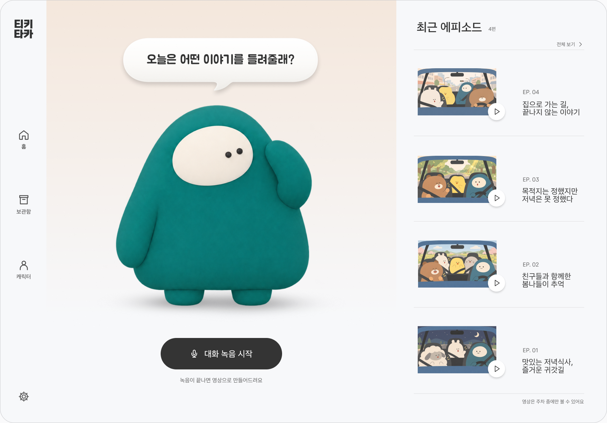

<sub>티키타카 홈 · Figma 디자인 시안</sub>

</div>

## 시연 영상

[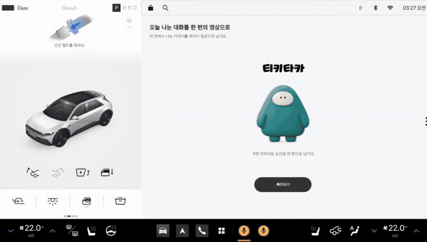](docs/videos/tikitaka-demo.mp4)

<sub>첫 설정부터 녹음, 주행 중 녹음 화면, 저장, 에피소드 감상까지 에뮬레이터에서 직접 조작한 화면입니다. 미리보기는 4배속·무음이며, 누르면 소리가 있는 [전체 영상(1분 17초)](docs/videos/tikitaka-demo.mp4)을 볼 수 있습니다.</sub>

## 주요 기능

| 기능 | 티키타카에서 하는 일 | 영상 |
| --- | --- | :---: |
| **대화 녹음** | 동의 후 녹음·일시정지·재개·저장. 영상 제작 없이 녹음만 보관할 수도 있습니다. | [③](#기능별-영상) |
| **하이라이트 찾기** | 기기에서 웃음과 음성을 분석하고, 전후 대화 맥락을 포함한 구간을 규칙 기반으로 선택합니다. | [④](#기능별-영상) |
| **제목과 캐릭터 동작** | 대사에서 제목을 추출하고, 발화·웃음·질문 구간에 맞춰 캐릭터 동작을 구성합니다. | [⑤](#기능별-영상) |
| **나를 닮은 캐릭터** | 8종 캐릭터 중 내 캐릭터를 선택하고, 화자 분석 결과를 바탕으로 영상 속 인물을 배치합니다. | [①](#기능별-영상) [②](#기능별-영상) |
| **에피소드 보관함** | 원본 녹음, 제작 상태, 완성 영상을 확인하고 재생합니다. 영상이 만들어지지 않은 제작 항목은 삭제할 수 있고, 원본 녹음은 남습니다. | [③](#기능별-영상) |
| **차량 환경에 맞춘 재생** | 주행 제한이나 차량 상태 미확인 시 영상을 잠급니다. 주차로 돌아와도 사용자가 눌러야 재생합니다. | [③](#기능별-영상) |

### 기능별 영상

에뮬레이터에서 직접 조작한 화면입니다. 미리보기는 무음이며, 누르면 소리가 있는 영상을 볼 수 있습니다.

**① 나를 닮은 캐릭터 · 이름과 캐릭터 설정**

[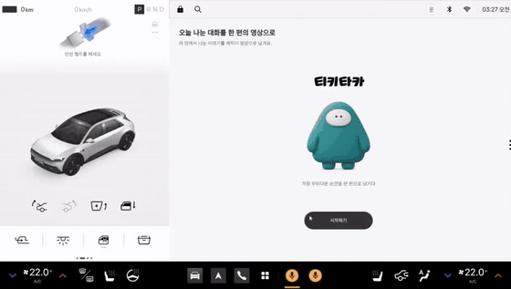](docs/videos/feature-1-profile-setup.mp4)

<sub>시작 안내와 마이크 권한을 지나 이름과 내 캐릭터를 정합니다. (12초)</sub>

**② 나를 닮은 캐릭터 · 내 목소리 등록**

[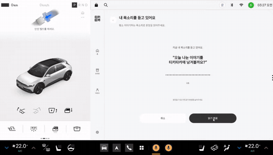](docs/videos/feature-2-voice-enroll.mp4)

<sub>안내 문장을 읽어 내 목소리를 등록하면, 영상에서 내 캐릭터가 내 대사를 맡습니다. (10초)</sub>

**③ 대화 녹음 · 차량 환경에 맞춘 재생 · 에피소드 보관함**

[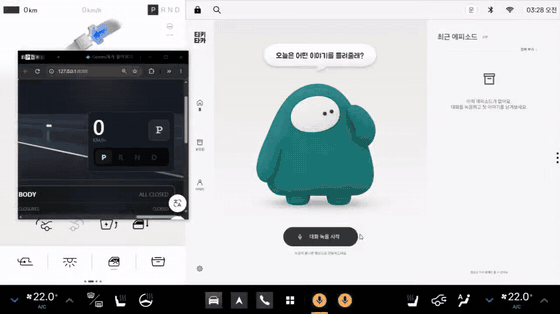](docs/videos/feature-3-recording-driving.mp4)

<sub>동승자 안내 후 녹음을 시작하고, 기어를 D로 바꿔도 녹음 화면이 유지됩니다. 주차 후 녹음을 마치고 저장합니다. (25초)</sub>

**④ 하이라이트 찾기**

[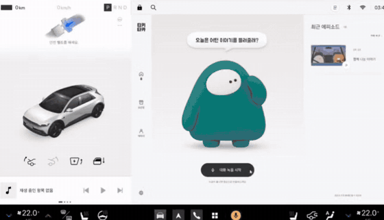](docs/videos/feature-4-highlight-production.mp4)

<sub>녹음을 마치면 기기에서 분석이 진행되고, 완성된 에피소드가 보관함에 추가됩니다. (16초)</sub>

**⑤ 제목과 캐릭터 동작**

[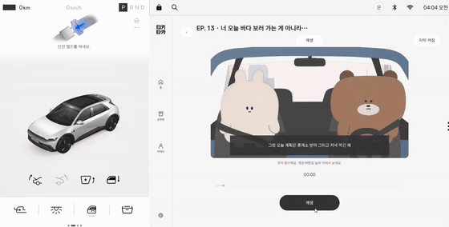](docs/videos/feature-5-episode-playback.mp4)

<sub>대사에서 뽑은 제목이 붙고, 말하는 사람과 웃음에 맞춰 캐릭터가 움직입니다. (13초)</sub>

### 사용 흐름

1. **준비하기** — 내 이름과 캐릭터를 정하고, 함께 탄 사람에게 녹음을 안내합니다.
2. **대화 남기기** — 주차 상태에서 동의와 마이크 권한을 확인한 뒤 녹음을 시작합니다.
3. **에피소드 만들기** — 녹음을 마치면 기기에서 분석·하이라이트 선택·영상 제작을 진행합니다.
4. **다시 즐기기** — 보관함에서 원본을 듣거나, 주차 상태에서 캐릭터 영상을 재생합니다.

## 화면

**Figma 디자인 시안**

| 내 캐릭터 선택 | 에피소드 보관함 |
| :---: | :---: |
| 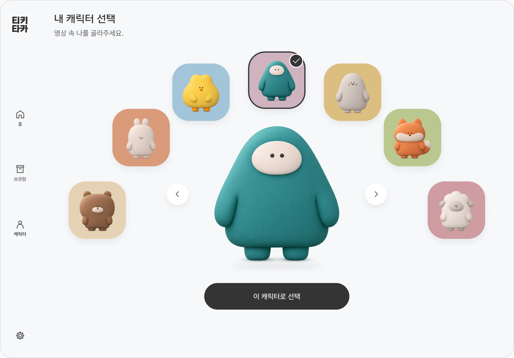 |  |
| 영상 속 나를 표현할 캐릭터를 선택합니다. | 완성된 에피소드와 녹음한 대화를 모아 봅니다. |

<details>
<summary>좁은 화면과 녹음 준비 시안 보기</summary>

| 좁은 홈 | 녹음 준비 |
| :---: | :---: |
| 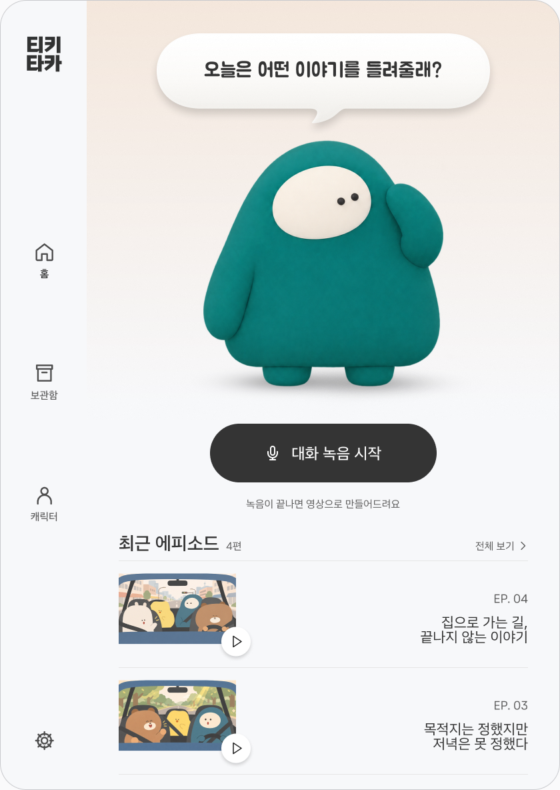 |  |

</details>

[Figma 디자인 원본](https://www.figma.com/design/Y5hqYUqZsj6gQu1QyixBYv/%ED%98%84%EB%8C%80%EC%9E%90%EB%8F%99%EC%B0%A8%EA%B7%B8%EB%A3%B9_%EC%B0%A8%EB%9F%89%EC%9A%A9_%EC%95%B1_%EA%B0%9C%EB%B0%9C_%EA%B3%B5%EB%AA%A8%EC%A0%84?node-id=616-3027&p=f&t=Few87s4eOpQAWe6L-0) · [이미지 출처](docs/images/readme/sources.json)

## 한눈에 보는 구조

운전자와 동승자는 평소처럼 대화만 합니다. 실선은 기록되어 영상의 재료가 되는 것이고, 점선은 녹음의 시작·일시정지·종료와 감상 시점을 바꾸는 차량 신호입니다.

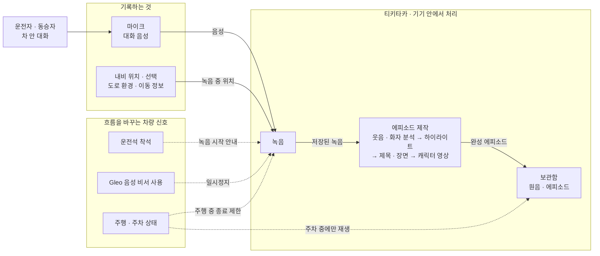

주행 중에는 녹음 화면만 남기고, 녹음 종료와 영상 감상은 주차 후에 합니다. 원음과 전사문은 기기 밖으로 보내지 않습니다.

시동을 끄면 녹음을 자동으로 마감하는 기능은 넣지 않았습니다. 현재 Pleos Vehicle SDK와 에뮬레이터가 시동 상태를 제공하지 않기 때문이며, SDK에 추가되면 연동할 계획입니다.

### 핵심 흐름: 녹음을 마치면 대화가 에피소드가 된다

주차 후 녹음을 종료하면 저장 확인부터 영상 제작까지 자동으로 이어지는 순서입니다.

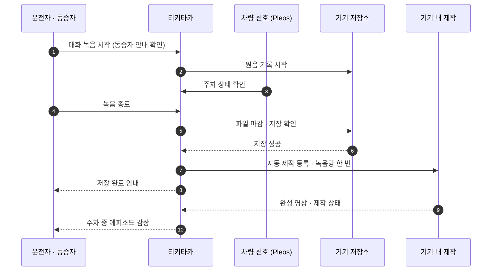

| 경우 | 처리 |
| --- | --- |
| "이번에는 녹음만 보관"을 골랐을 때 | 7번을 건너뛰고 녹음 보관함에만 저장 |
| 저장 실패 · 무음 · 중단 후 복구한 녹음 | 자동 제작에서 제외. 원음은 보관하고, 보관함에서 직접 제작 가능 |
| 다른 녹음이 진행 중일 때 | 제작을 대기로 두었다가 녹음이 끝나면 이어감 |


## 기술 구성

### 활용 Pleos SDK

| SDK | 버전 | 활용 기능 |
| --- | --- | --- |
| **Pleos Vehicle SDK** | **2.3.2** | 운전석 착석 상태 조회·변경 감지 및 탑승 안내 |
| **Pleos SpeechToText SDK** | **3.3.1** | `ON_DEVICE` 모드로 녹음 음성을 텍스트로 변환하여 자막과 제목 추출에 활용 |
| **Pleos NaviHelper SDK** | **3.0.5** | 녹음 당시 현재 주소·가까운 분기 안내를 읽어 영상 배경 환경 판별 |

### 처리 흐름

**녹음 → 음성·웃음 분석 → 하이라이트 → 제목·장면 구성 → 캐릭터 영상 → 보관함**

음성 분석부터 캐릭터 영상 제작까지 기기에서 처리합니다. **제작 과정에서 원음과 전사문을 외부 서버로 전송하지 않습니다.**

| 처리 단계 | 사용 기술 |
| --- | --- |
| 차량 좌석 정보와 탑승 안내 | Pleos Vehicle SDK |
| 음성 인식 | Pleos SpeechToText `ON_DEVICE` |
| 웃음 감지·화자 분석 | YAMNet 및 기기 내 음성 분석 |
| 대화 제목·장면 계획 | Kotlin 텍스트 규칙: 핵심 문장 추출, 길이 제한, 대화 구간별 시선 연출 |
| 영상 배경 선택 | 녹음 시 저장한 내비 환경의 하이라이트 구간별 우세 시간 |
| 캐릭터 영상 저장 | Android Media3, 제공된 캐릭터·차량·배경 에셋 |
| 주행 중 영상 제한 | Android Automotive `CarUxRestrictions` |

위치 사용을 허용하면 녹음 중 주소·분기 안내로 도로 환경을 추정해 도시·고속도로 배경을 선택합니다. 정보가 부족하면 기본 배경을 사용합니다. 배경은 영상 길이에 맞춰 반복하고, 원본 녹음을 오디오로 사용합니다.

### 화자와 캐릭터가 연결되는 과정

화자를 나누는 일, 내 목소리를 찾는 일, 캐릭터를 배정하는 일은 서로 다른 단계입니다.

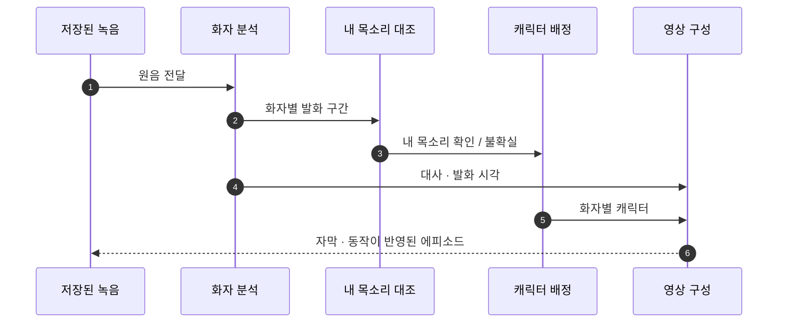

| 대조 결과 | 캐릭터 |
| --- | --- |
| 내 목소리로 확인됨 | 설정에서 고른 내 캐릭터 |
| 목소리 미등록 · 결과 불확실 · 동승자 | 나머지 캐릭터를 자동 배정 |

같은 녹음 안에서 같은 화자는 같은 캐릭터를 유지합니다. 내 목소리 등록은 선택 사항이며, 동승자가 누구인지 기억하거나 대사를 사람별로 직접 지정하는 기능은 없습니다. 목소리 대조는 기기 안에서 처리하며 본인 인증 용도가 아닙니다.


## 실행 방법

### 제출용 APK 설치

1. [GitHub Release에서 서명된 APK를 다운로드합니다.](https://github.com/Controllls/tikitaka/releases/tag/v1.2.3) 파일 크기(약 292MB) 때문에 저장소 대신 Release에 등록했으며, 위치 안내는 [apk/README.md](apk/README.md)에 있습니다.
2. Android Studio의 Device Manager에서 **Pleos Connect Emulator v2.1.0 / Android 14(API 34), x86_64** 환경을 준비합니다. 기존 개발 앱과 서명키가 다를 수 있으므로 테스트용 새 AVD를 사용합니다.
3. APK를 내려받아 설치하고 실행합니다.

```powershell
adb devices
curl.exe -L -o GongDongGeun_TikiTaka_release.apk https://github.com/Controllls/tikitaka/releases/download/v1.2.3/GongDongGeun_TikiTaka_release.apk
adb install GongDongGeun_TikiTaka_release.apk
adb shell am start -n com.example.hd_project/.MainActivity
```

### 테스트 환경과 설정

| 항목 | 설정 |
| --- | --- |
| 플랫폼 | Pleos Connect Emulator v2.1.0 / Android 14(API 34) / x86_64 |
| 기본 가로 테스트 규격 | 앱 창 **1700 × 1184dp**, 160dpi — FormFactorConsole의 Standard 17인치 Landscape |
| 화면 크기 변경 | [공식 FormFactorConsole 가이드](https://document.pleos.ai/docs/pleos-only/app-test-guide/form-factor-test-guide)에 따라 별도 가상 디스플레이에서 실행 |
| 음성 입력 | PC 마이크 접근 및 에뮬레이터 마이크 입력 활성화, 앱의 마이크 권한 허용 |
| 영상 감상 | 주차 상태, 차량의 주행 제한이 해제된 상태 |

일반 에뮬레이터 창은 Pleos 시스템의 창 배치에 따라 크기가 달라집니다. 정확한 규격 테스트에는 FormFactorConsole을 사용합니다. 화면에 배치된 가상 차량 상태는 [Pleos Virtual Console](https://document.pleos.ai/docs/pleos-only/app-test-guide/virtual-console-guide)에서 변경합니다.

### 시연 시나리오와 기능

어떤 시나리오가 어떤 기능을 보여 주는지 정리한 지도입니다. ①~⑤는 정상 흐름, ⑥~⑨는 예외 흐름, ⑩은 감상입니다.

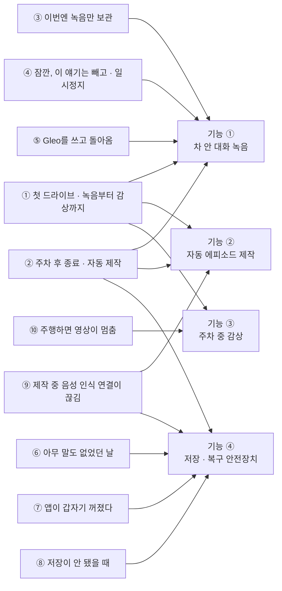

### 기본 시연 순서

1. **초기 설정:** 시작하기 → 권한 안내 → 마이크 허용 → 위치 사용 선택 후 이름·캐릭터를 설정합니다. 위치 사용과 내 목소리 등록은 선택 사항입니다.
2. **녹음:** 주차 상태에서 대화 녹음 시작을 누르고 동의 확인과 마이크 권한 허용을 진행합니다. 동의받은 대화를 녹음하고 일시정지·재개·저장을 확인합니다.
3. **영상 제작:** 영상 제작을 선택한 녹음을 종료한 뒤 보관함에서 분석·제작 상태를 확인합니다. ‘녹음만 보관’을 선택한 경우 녹음 보관함에서 원음을 확인합니다.
4. **감상:** 제작 완료된 에피소드의 상세에서 제목·날짜·영상 길이를 확인한 뒤 재생합니다.
5. **저장 유지:** 앱을 종료하고 다시 실행해 녹음과 완성 영상이 유지되는지 확인합니다.
6. **주행 제한:** 녹음 중 가상 주행 상태(기어 D)로 바꾸면 녹음 화면이 유지되고, 녹음 종료는 주차 후에만 할 수 있습니다. 영상 재생·탐색은 차단되며, 주차 상태로 돌아온 뒤에는 재생 버튼을 직접 누릅니다.

### 소스 빌드

Android SDK Platform 37과 JDK 25가 필요합니다. Android Studio로 프로젝트를 열면 SDK 위치가 담긴 `local.properties`가 자동으로 만들어집니다. 명령줄에서만 빌드할 때는 이 파일이 없으므로 `ANDROID_HOME`에 SDK 경로를 먼저 지정합니다.

```powershell
# 명령줄에서만 빌드할 때: SDK 경로 지정 (Android Studio 기본 설치 위치)
$env:ANDROID_HOME = "$env:LOCALAPPDATA\Android\Sdk"

.\gradlew.bat :app:assembleDebug
adb install -r app/build/outputs/apk/debug/app-debug.apk
adb shell am start -n com.example.hd_project/.MainActivity
```

### 빌드 환경

| 항목 | 프로젝트 설정 |
| --- | --- |
| 패키지 / 버전 | `com.example.hd_project` / `1.2.3` (`versionCode 6`) |
| Android SDK | minSdk **28**, compileSdk / targetSdk **37** |
| Gradle / Android Gradle Plugin | **9.6.0 / 9.4.1** |
| Gradle JVM / Java 소스 호환성 | **JDK 25 / Java 17** |
| Pleos Vehicle / SpeechToText | **2.3.2 / 3.3.1** |
| Media3 | **1.9.0** |
| 음성 분석 네이티브 라이브러리 | ONNX Runtime / sherpa-onnx, `arm64-v8a`·`x86_64` 포함 |

Pleos Maven 저장소: [settings.gradle.kts](settings.gradle.kts)

검증 현황: [VALIDATION.md](docs/VALIDATION.md)

```powershell
# 단위 테스트 및 release 정적 검사
.\gradlew.bat :app:testDebugUnitTest :app:lintRelease

# 서명 전 release APK 생성
.\gradlew.bat :app:assembleRelease
```

## 저장소 구성

```text
app/       Android 앱, 화면·녹음·기기 분석·영상 제작, 테스트
docs/      검증 현황·개발 규칙·출처와 README 이미지
tools/     서명·기기 테스트 도구
third_party/  이식한 코드의 원본 라이선스
```

## 라이선스

서드파티 모델·라이브러리·폰트의 출처와 라이선스는 [서드파티 고지](docs/THIRD_PARTY.md)와 [NOTICE](app/src/main/assets/third_party/NOTICE.txt)에 명시되어 있습니다.
