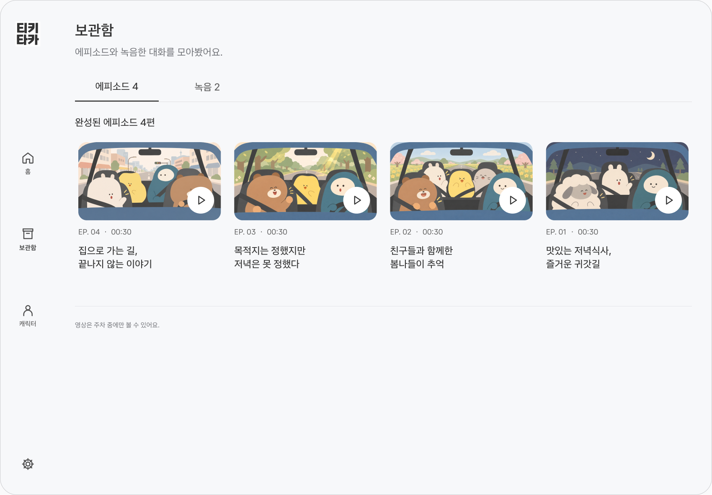
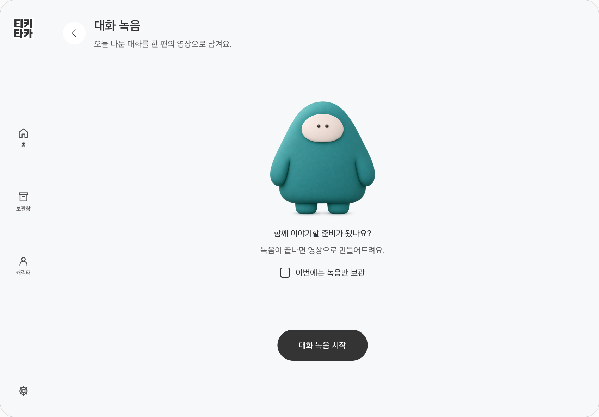
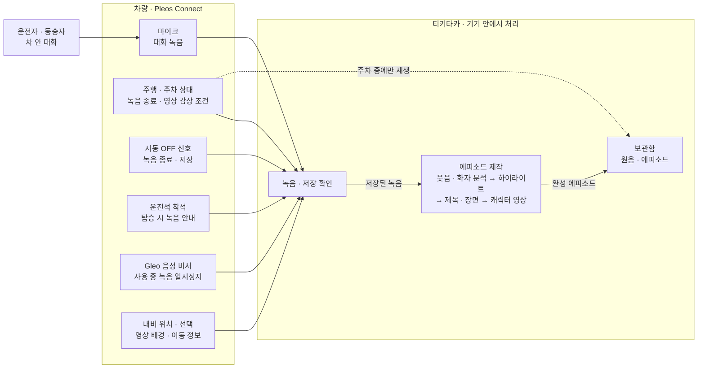

<div align="center">

# 티키타카 · TikiTaka

### 차 안에서 나눈 대화를, 우리만의 캐릭터 에피소드로.

함께 웃었던 순간을 녹음하고, 하이라이트와 캐릭터 영상으로 다시 만나는 **Pleos Connect 차량용 앱**입니다.

**2026 현대자동차그룹 차량용 앱 개발 공모전 프로젝트**

[주요 기능](#주요-기능) · [화면](#화면) · [기술 구성](#기술-구성) · [실행 방법](#실행-방법)


<sub>티키타카 홈 · Figma 디자인 시안</sub>

</div>

## 주요 기능

| 기능 | 티키타카에서 하는 일 |
| --- | --- |
| **대화 녹음** | 동의 후 녹음·일시정지·재개·저장. 영상 제작 없이 녹음만 보관할 수도 있습니다. |
| **하이라이트 찾기** | 기기에서 웃음과 음성을 분석하고, 전후 대화 맥락을 포함한 구간을 규칙 기반으로 선택합니다. |
| **제목과 캐릭터 동작** | 대사에서 제목을 추출하고, 발화·웃음·질문 구간에 맞춰 캐릭터 동작을 구성합니다. |
| **나를 닮은 캐릭터** | 8종 캐릭터 중 내 캐릭터를 선택하고, 화자 분석 결과를 바탕으로 영상 속 인물을 배치합니다. |
| **에피소드 보관함** | 원본 녹음, 제작 상태, 완성 영상을 확인하고 재생합니다. |
| **차량 환경에 맞춘 재생** | 주행 제한이나 차량 상태 미확인 시 영상을 잠급니다. 주차로 돌아와도 사용자가 눌러야 재생합니다. |

### 사용 흐름

1. **준비하기** — 내 이름과 캐릭터를 정하고, 함께 탄 사람에게 녹음을 안내합니다.
2. **대화 남기기** — 주차 상태에서 동의와 마이크 권한을 확인한 뒤 녹음을 시작합니다.
3. **에피소드 만들기** — 녹음을 마치면 기기에서 분석·하이라이트 선택·영상 제작을 진행합니다.
4. **다시 즐기기** — 보관함에서 원본을 듣거나, 주차 상태에서 캐릭터 영상을 재생합니다.

## 화면

**Figma 디자인 시안**

| 내 캐릭터 선택 | 에피소드 보관함 |
| :---: | :---: |
|  |  |
| 영상 속 나를 표현할 캐릭터를 선택합니다. | 완성된 에피소드와 녹음한 대화를 모아 봅니다. |

<details>
<summary>좁은 화면과 녹음 준비 시안 보기</summary>

| 좁은 홈 | 녹음 준비 |
| :---: | :---: |
|  |  |

</details>

[Figma 디자인 원본](https://www.figma.com/design/Y5hqYUqZsj6gQu1QyixBYv/Untitled?node-id=616-3028) · [이미지 출처](docs/images/readme/sources.json)

## 한눈에 보는 구조

운전자와 동승자는 평소처럼 대화만 합니다. 앱은 차량 신호로 녹음 화면과 종료 시점을 맞추고, 저장한 녹음을 기기 안에서 에피소드 영상으로 만듭니다.



주행 중에는 녹음 화면만 남기고, 녹음 종료와 영상 감상은 주차 후에 합니다. 원음과 전사문은 기기 밖으로 보내지 않습니다.

## 기술 구성

### 활용 Pleos SDK

| SDK | 버전 | 활용 기능 |
| --- | --- | --- |
| **Pleos Vehicle SDK** | **2.3.2** | 운전석 착석 상태 조회·변경 감지 및 탑승 안내 |
| **Pleos SpeechToText SDK** | **3.3.1** | `ON_DEVICE` 모드로 녹음 음성을 텍스트로 변환하여 자막과 제목 추출에 활용 |
| **Pleos NaviHelper SDK** | **3.0.5** | 녹음 당시 현재 주소·가까운 분기 안내를 읽어 영상 배경 환경 판별 |

### 처리 흐름

**녹음 → 음성·웃음 분석 → 하이라이트 → 제목·장면 구성 → 캐릭터 영상 → 보관함**

음성 분석부터 캐릭터 영상 제작까지 기기에서 처리합니다. **제작 과정에서 원음과 전사문을 외부 서버로 전송하지 않습니다.**

| 처리 단계 | 사용 기술 |
| --- | --- |
| 차량 좌석 정보와 탑승 안내 | Pleos Vehicle SDK |
| 음성 인식 | Pleos SpeechToText `ON_DEVICE` |
| 웃음 감지·화자 분석 | YAMNet 및 기기 내 음성 분석 |
| 대화 제목·장면 계획 | Kotlin 텍스트 규칙: 핵심 문장 추출, 길이 제한, 대화 구간별 시선 연출 |
| 영상 배경 선택 | 녹음 시 저장한 내비 환경의 하이라이트 구간별 우세 시간 |
| 캐릭터 영상 저장 | Android Media3, 제공된 캐릭터·차량·배경 에셋 |
| 주행 중 영상 제한 | Android Automotive `CarUxRestrictions` |

위치 사용을 허용하면 녹음 중 주소·분기 안내로 도로 환경을 추정해 도시·고속도로 배경을 선택합니다. 정보가 부족하면 기본 배경을 사용합니다. 배경은 영상 길이에 맞춰 반복하고, 원본 녹음을 오디오로 사용합니다.

## 실행 방법

### 제출용 APK 설치

1. [GitHub Release에서 서명된 APK를 다운로드합니다.](https://github.com/Controllls/tikitaka/releases/tag/v1.2.1) 파일 크기(약 292MB) 때문에 저장소 대신 Release에 등록했으며, 위치 안내는 [apk/README.md](apk/README.md)에 있습니다.
2. Android Studio의 Device Manager에서 **Pleos Connect Emulator v2.1.0 / Android 14(API 34), x86_64** 환경을 준비합니다. 기존 개발 앱과 서명키가 다를 수 있으므로 테스트용 새 AVD를 사용합니다.
3. APK를 내려받아 설치하고 실행합니다.

```powershell
adb devices
curl.exe -L -o TikiTaka_release.apk https://github.com/Controllls/tikitaka/releases/download/v1.2.1/TikiTaka_release.apk
adb install TikiTaka_release.apk
adb shell am start -n com.example.hd_project/.MainActivity
```

### 테스트 환경과 설정

| 항목 | 설정 |
| --- | --- |
| 플랫폼 | Pleos Connect Emulator v2.1.0 / Android 14(API 34) / x86_64 |
| 기본 가로 테스트 규격 | 앱 창 **1700 × 1184dp**, 160dpi — FormFactorConsole의 Standard 17인치 Landscape |
| 화면 크기 변경 | [공식 FormFactorConsole 가이드](https://document.pleos.ai/docs/pleos-only/app-test-guide/form-factor-test-guide)에 따라 별도 가상 디스플레이에서 실행 |
| 음성 입력 | PC 마이크 접근 및 에뮬레이터 마이크 입력 활성화, 앱의 마이크 권한 허용 |
| 영상 감상 | 주차 상태, 차량의 주행 제한이 해제된 상태 |

일반 에뮬레이터 창은 Pleos 시스템의 창 배치에 따라 크기가 달라집니다. 정확한 규격 테스트에는 FormFactorConsole을 사용합니다. 화면에 배치된 가상 차량 상태는 [Pleos Virtual Console](https://document.pleos.ai/docs/pleos-only/app-test-guide/virtual-console-guide)에서 변경합니다.

### 기본 시연 순서

1. **초기 설정:** 시작하기 → 권한 안내 → 마이크 허용 → 위치 사용 선택 후 이름·캐릭터를 설정합니다. 위치 사용과 내 목소리 등록은 선택 사항입니다.
2. **녹음:** 주차 상태에서 대화 녹음 시작을 누르고 동의 확인과 마이크 권한 허용을 진행합니다. 동의받은 대화를 녹음하고 일시정지·재개·저장을 확인합니다.
3. **영상 제작:** 영상 제작을 선택한 녹음을 종료한 뒤 보관함에서 분석·제작 상태를 확인합니다. ‘녹음만 보관’을 선택한 경우 녹음 보관함에서 원음을 확인합니다.
4. **감상:** 제작 완료된 에피소드의 상세에서 제목·날짜·영상 길이를 확인한 뒤 재생합니다.
5. **저장 유지:** 앱을 종료하고 다시 실행해 녹음과 완성 영상이 유지되는지 확인합니다.
6. **주행 제한:** 녹음 중 가상 주행 상태(기어 D)로 바꾸면 녹음 화면이 유지되고, 녹음 종료는 주차 후에만 할 수 있습니다. 영상 재생·탐색은 차단되며, 주차 상태로 돌아온 뒤에는 재생 버튼을 직접 누릅니다.

### 소스 빌드

```powershell
.\gradlew.bat :app:assembleDebug
adb install -r app/build/outputs/apk/debug/app-debug.apk
adb shell am start -n com.example.hd_project/.MainActivity
```

### 빌드 환경

| 항목 | 프로젝트 설정 |
| --- | --- |
| 패키지 / 버전 | `com.example.hd_project` / `1.2.1` (`versionCode 4`) |
| Android SDK | minSdk **28**, compileSdk / targetSdk **37** |
| Gradle / Android Gradle Plugin | **9.6.0 / 9.4.1** |
| Gradle JVM / Java 소스 호환성 | **JDK 25 / Java 17** |
| Pleos Vehicle / SpeechToText | **2.3.2 / 3.3.1** |
| Media3 | **1.9.0** |
| 음성 분석 네이티브 라이브러리 | ONNX Runtime / sherpa-onnx, `arm64-v8a`·`x86_64` 포함 |

Pleos Maven 저장소: [settings.gradle.kts](settings.gradle.kts)

검증 현황: [VALIDATION.md](docs/VALIDATION.md)

```powershell
# 단위 테스트 및 release 정적 검사
.\gradlew.bat :app:testDebugUnitTest :app:lintRelease

# 서명 전 release APK 생성
.\gradlew.bat :app:assembleRelease
```

## 저장소 구성

```text
app/       Android 앱, 화면·녹음·기기 분석·영상 제작, 테스트
docs/      검증 현황·개발 규칙·출처와 README 이미지
tools/     서명·기기 테스트 도구
third_party/  이식한 코드의 원본 라이선스
```

## 라이선스

서드파티 모델·라이브러리·폰트의 출처와 라이선스는 [서드파티 고지](docs/THIRD_PARTY.md)와 [NOTICE](app/src/main/assets/third_party/NOTICE.txt)에 명시되어 있습니다.
