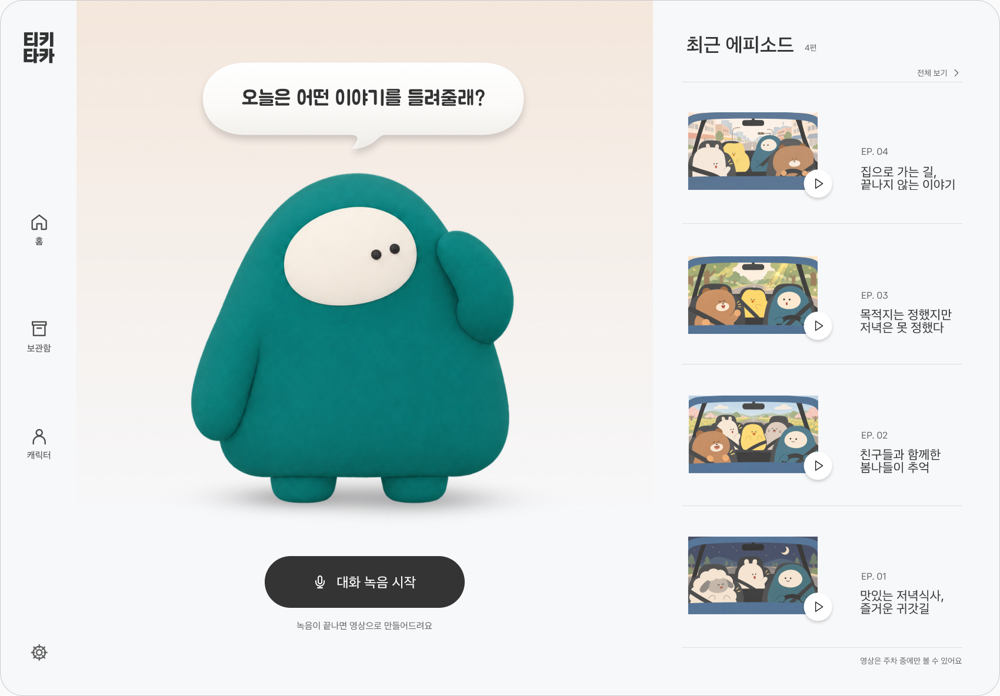
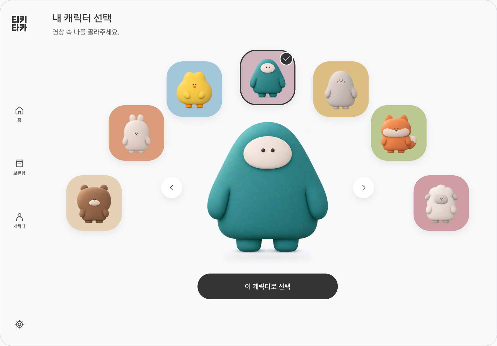
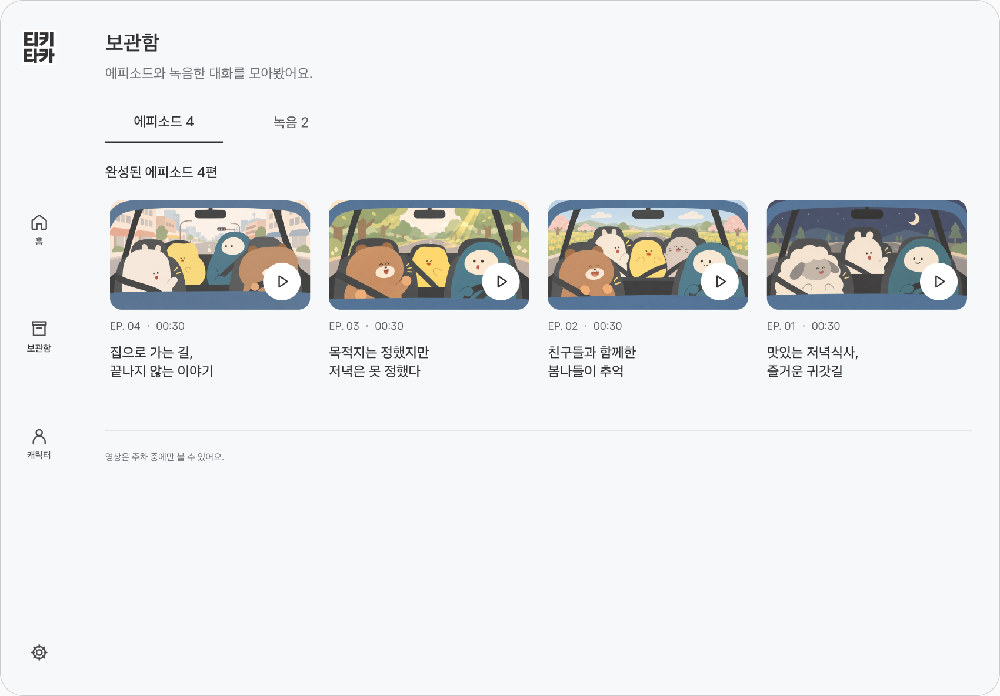
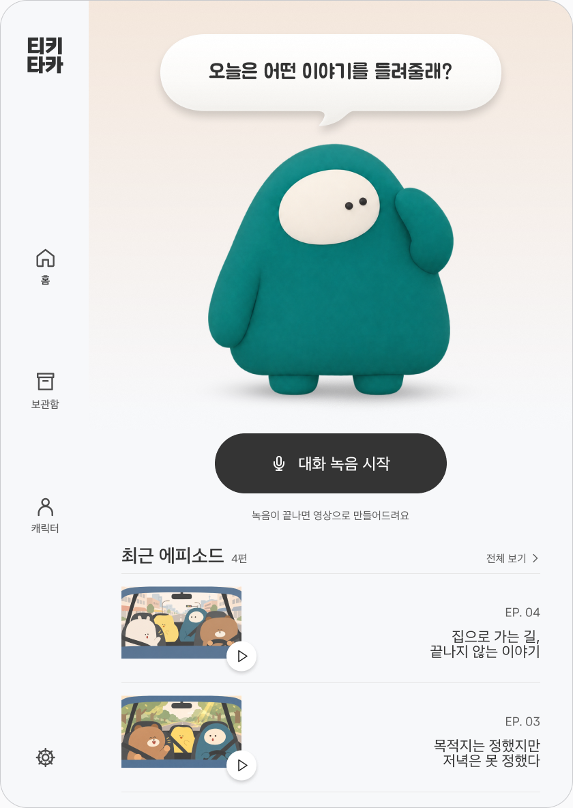
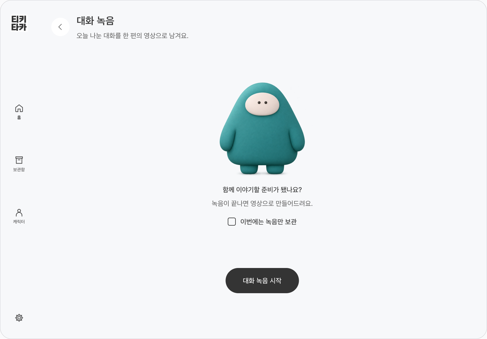

<div align="center">

# 티키타카 · TikiTaka

### 차 안에서 나눈 대화를, 우리만의 캐릭터 에피소드로.

함께 웃었던 순간을 녹음하고, 하이라이트와 캐릭터 영상으로 다시 만나는 **Pleos Connect 차량용 앱**입니다.

**2026 현대자동차그룹 차량용 앱 개발 공모전 프로젝트**

[주요 기능](#주요-기능) · [화면](#화면) · [기술 구성](#기술-구성) · [실행 방법](#실행-방법)



<sub>티키타카 홈 · Figma 디자인 시안</sub>

</div>

## 어떤 순간을 남기나요?

여행지로 향하며 나눈 이야기, 친구들과 돌아오는 길의 농담, 가족끼리 함께 웃었던 순간. 티키타카는 사진으로 남기기 어려운 **차 안의 대화**를 짧은 에피소드로 보관합니다.

탑승자의 동의를 확인하고 녹음을 시작하면 원음을 기기에 저장합니다. 녹음이 끝난 뒤 웃음과 대화 구간을 분석하고, 캐릭터의 말하기·웃음 동작과 함께 영상으로 구성합니다. 완성된 에피소드는 **주차 상태에서** 다시 볼 수 있습니다.

## 주요 기능

| 기능 | 티키타카에서 하는 일 |
| --- | --- |
| **대화 녹음** | 동의 후 녹음·일시정지·재개·저장. 영상 제작 없이 녹음만 보관할 수도 있습니다. |
| **하이라이트 찾기** | 기기에서 웃음과 음성을 분석하고, 전후 대화 맥락을 포함한 구간을 규칙 기반으로 선택합니다. |
| **대화에 맞는 제목과 캐릭터 동작** | 전사문에서 반복되는 단어와 문장 길이를 기준으로 핵심 문장을 골라 24자 이내 제목을 설정합니다. 차량 구도는 고정하고, 음성과 질문 구간에 맞춰 캐릭터가 말하고 서로 바라봅니다. |
| **나를 닮은 캐릭터** | 8종 캐릭터 중 내 캐릭터를 선택하고, 화자 분석 결과를 바탕으로 영상 속 인물을 배치합니다. |
| **에피소드 보관함** | 원본 녹음, 제작 상태, 완성 영상을 확인하고 다시 듣거나 재생합니다. 보관함 메뉴를 다시 누르면 에피소드 탭의 맨 위로 돌아갑니다. |
| **차량 환경에 맞춘 재생** | 주행 제한이나 차량 상태 미확인 시 영상을 잠급니다. 주차로 돌아와도 사용자가 눌러야 재생합니다. |

### 사용 흐름

1. **준비하기** — 내 이름과 캐릭터를 정하고, 함께 탄 사람에게 녹음을 안내합니다.
2. **대화 남기기** — 주차 상태에서 동의와 마이크 권한을 확인한 뒤 녹음을 시작합니다.
3. **에피소드 만들기** — 녹음을 마치면 기기에서 분석·하이라이트 선택·영상 제작을 진행합니다.
4. **다시 즐기기** — 보관함에서 원본을 듣거나, 주차 상태에서 캐릭터 영상을 재생합니다.

## 화면

**Figma 디자인 시안**

| 내 캐릭터 선택 | 에피소드 보관함 |
| :---: | :---: |
|  |  |
| 영상 속 나를 표현할 캐릭터를 선택합니다. | 완성된 에피소드와 녹음한 대화를 모아 봅니다. |

<details>
<summary>좁은 화면과 녹음 준비 시안 보기</summary>

| 좁은 홈 | 녹음 준비 |
| :---: | :---: |
|  |  |

</details>

[Figma 디자인 원본](https://www.figma.com/design/Y5hqYUqZsj6gQu1QyixBYv/Untitled?node-id=616-3028) · [제출 자료 페이지](https://www.figma.com/design/Y5hqYUqZsj6gQu1QyixBYv/Untitled?node-id=1042-1935) · [이미지 출처](docs/images/readme/sources.json)

## 기술 구성

**녹음 → 음성·웃음 분석 → 하이라이트 → 제목·장면 구성 → 캐릭터 영상 → 보관함**

음성 분석부터 캐릭터 영상 제작까지 기기에서 처리합니다. **제작 과정에서 원음과 전사문을 외부 서버로 전송하지 않습니다.**

| 처리 단계 | 사용 기술 |
| --- | --- |
| 차량 좌석 정보와 탑승 안내 | Pleos Vehicle SDK |
| 음성 인식 | Pleos SpeechToText `ON_DEVICE` |
| 웃음 감지·화자 분석 | YAMNet 및 기기 내 음성 분석 |
| 대화 제목·장면 계획 | Kotlin 텍스트 규칙: 핵심 문장 추출, 길이 제한, 대화 구간별 시선 연출 |
| 캐릭터 영상 저장 | Android Media3, 제공된 캐릭터·차량·배경 에셋 |
| 주행 중 영상 제한 | Android Automotive `CarUxRestrictions` |

**제목 설정에 별도 언어 모델 다운로드나 외부 API가 필요하지 않습니다.** 대사가 있으면 원문에서 제목을 고르고, 확인된 대사가 없으면 기본 제목과 전체 구도를 사용합니다. 이전 버전이 저장한 제목 모델과 미완료 다운로드는 업데이트 후 앱 실행 시 정리하며, 기존 녹음·완성 영상·분석 기록은 유지합니다.

## 실행 방법

### Pleos Connect에서 실행

1. Android Studio에서 **Pleos Connect Emulator v2.1.0 / Android 14(API 34)** 환경을 준비합니다.
2. 아래 소스 빌드 방법으로 debug APK를 생성합니다.
3. 테스트용 에뮬레이터에 설치하고 앱 목록에서 **티키타카**를 실행합니다.
4. 내 프로필과 마이크 권한을 설정합니다. 영상 재생은 주차 상태에서 확인합니다.
5. 짧은 대화를 녹음하고 종료한 뒤 보관함에서 제작 상태와 결과를 확인합니다.

```powershell
# Windows / 프로젝트 루트
.\gradlew.bat :app:assembleDebug

# adb가 PATH에 등록된 환경. 여러 기기 연결 시 -s <serial>을 추가합니다.
adb install -r app/build/outputs/apk/debug/app-debug.apk
adb shell am start -n com.example.hd_project/.MainActivity
```

### 빌드 환경

| 항목 | 프로젝트 설정 |
| --- | --- |
| 패키지 / 버전 | `com.example.hd_project` / `1.1` (`versionCode 2`) |
| Android SDK | minSdk **28**, compileSdk / targetSdk **37** |
| Gradle / Android Gradle Plugin | **9.6.0 / 9.4.1** |
| Gradle JVM / Java 소스 호환성 | **JDK 25 / Java 17** |
| Pleos Vehicle / SpeechToText | **2.3.2 / 3.3.1** |
| Media3 | **1.9.0** |
| 음성 분석 네이티브 라이브러리 | ONNX Runtime / sherpa-onnx, `arm64-v8a`·`x86_64` 포함 |

Pleos Maven 저장소는 [settings.gradle.kts](settings.gradle.kts)에 설정되어 있습니다. 제목 설정 코드는 Kotlin으로 빌드되며 별도 C++ 빌드 단계가 없습니다. 음성 분석용 네이티브 라이브러리의 출처는 [서드파티 고지](docs/THIRD_PARTY.md)를 참고하세요.

```powershell
# 단위 테스트 및 release 정적 검사
.\gradlew.bat :app:testDebugUnitTest :app:lintRelease

# 서명 전 release APK 생성
.\gradlew.bat :app:assembleRelease
```

## 저장소 구성

```text
app/       Android 앱, 화면·녹음·기기 분석·영상 제작, 테스트
docs/      검증 현황·개발 규칙·출처와 README 이미지
tools/     서명·기기 테스트 도구
third_party/  이식한 코드의 원본 라이선스
```

## 라이선스

서드파티 모델·라이브러리·폰트의 출처와 라이선스는 [서드파티 고지](docs/THIRD_PARTY.md)와 [NOTICE](app/src/main/assets/third_party/NOTICE.txt)에 명시되어 있습니다.
