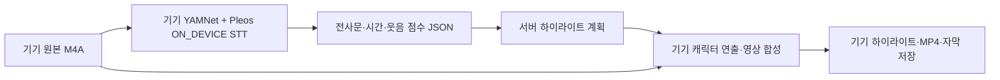

# 기기 분석·메타데이터 서버·기기 영상 제작

기준: 2026-11-13. 현재 앱의 새 영상 제작 경로를 설명한다. 기존 웹 실험실의 음성 업로드/Whisper/Qwen/서버 렌더링 경로와 다르며, 이전 웹 연동 문서의 새 녹음 처리 설명을 대체한다.

### 2026-11-13 Figma 영상 비율 적용 (현재 렌더러 V7)

새 영상은 `tikitaka-local-wide-v7`로 1280×720(16:9) 생성한다. 앱 창의 방향과 무관하게 사용 가능한 너비에 맞춰 같은 비율로 표시한다. Figma 가로 E-02의 1120×630, 세로 E-02의 645×362.813 영상 영역을 실제 원본과 대조했다. 1280×720 px는 프로젝트의 인코딩 선택이며 Pleos 앱 창 dp 규격과 별개다.

아래 V6의 화자 분석·웃음 감도 0.01은 그대로 유지한다. 차량 장면의 구도와 영상 크기만 변경하고, 기존 세로 파일은 보존한다. 새 파일은 `wide7` 이름으로 저장한다. 기존 약 20초 음원을 58.407초에 재제작했으며 원본과 이전 영상 12개의 보존, H.264 1280×720 및 단일 AAC 오디오를 확인했다. JVM 51개, 회귀 계측 7개, 재제작 계측 1개, 12개 앱 창 크기 × 진단 접힘/펼침 24개 배치 검사를 통과했다. 실차·ARM64·실제 FormFactorConsole 전체 조합은 미검증이다. 디자인 근거·규칙·SDK·검증 범위는 [영상 비율 수정 기록](FIGMA_IMPLEMENTATION_2026-11-12.md)에 정리했다.

### 2026-11-13 실제 화자 구분 및 웃음 감도 0.01 적용 (V7에서도 유지)

사용자의 ‘구현해봐, 필터는 0.01로 해’ 요청으로 전체 화자 구분을 다시 활성화했다. 아래 과거 기록의 ‘자동 다중 분리 꺼짐’ 설명은 이전 영상에만 해당한다. 이 화자 분석 변경을 검증한 당시 렌더러는 `tikitaka-local-diarization-v6`이며, 아래 측정값은 V6 검증 이력이다. 현재 V7에서도 분석 로직을 유지하며 기존 MP4와 진단 파일을 덮어쓰지 않는다.

- **웃음 감도:** 0.01 / 0.05 / 0.10 / 0.20을 두 설정 화면에서 선택한다. 새 설치 기본값과 현재 에뮬레이터 설정은 0.01이다. 저장된 기존 설정을 일괄 덮어쓰지 않으며, 진행 중인 작업은 시작할 때 저장한 값을 유지한다. 요청한 기존 녹음은 명시적으로 0.01로 재분석했다. 낮은 임계값은 작은 웃음을 더 받아들이지만 다른 소리를 웃음으로 오감지할 수도 있다.
- **실제 분석:** 선택된 최대 120초 영상 구간을 기기에서 16kHz mono PCM으로 읽고, pyannote segmentation-3.0 INT8로 발화/겹침 구간을 구한다. ERes2Net-base의 목소리 특징을 자동 군집화하여 화자 번호를 부여한다. 등록 목소리가 없어도 동작한다. CAM++는 별도의 ‘내 목소리 확인’ 용도로 유지한다.
- **프로젝트 구현 규칙:** 군집 임계값 0.9, 발화 on/off 최소 길이 0.25/0.3초, 군집의 유효 발화 합계 최소 2초, 유효 군집 점수 하한 0.35, 최대 표시 화자 4명이다. Pleos 공식 수치가 아니며 웃음 임계값 0.01과 별개다. 지원이 부족한 군집/구간은 불분명으로 남기고, 한 명을 무조건 두 명으로 나누지 않는다. 모델이 점수를 제공하지 않는 경우(`-2`)는 `null`/`—`로 보존한다.
- **번호와 신원:** 화자 번호는 영상 구간 안에서만 유지한다. 다른 영상에서도 동일인이 같은 번호를 받는다는 보장은 없다. 사람 이름·탑승자 수를 추정하지 않는다. 등록된 내 목소리와 단독 발화 특징이 충분히 일치할 때만 내 캐릭터를 연결한다. 다른 화자와 겹친 구간은 내 목소리 확인에서 제외한다.
- **자막·동작:** 기존 SDK 전사문을 화자 구간에 맞춰 한 번씩만 배분한다. 같은 자막을 두 사람에게 복제하지 않는다. 입 움직임과 상단 화자 감지는 긴 STT 문장 길이가 아닌 실제 분석 구간을 사용한다. 실제로 겹친 것으로 분석된 구간에는 둘 다 발화 상태가 될 수 있다. 단어별 시각이 없으므로 문장 내부의 단어 배정은 길이 비례 추정이며, 겹침/불명 구간의 자막에는 화자를 확정하지 않는다.
- **진단 UI:** 재생 시 `화자 1: ● 감지됨 · 점수 ...`, `화자 2: 대기`를 100ms마다 갱신한다. 해당 화자 행을 초록색, 불분명 발화를 노란색으로 강조한다. 웃음 원점수·필터·최종 반영·감도도 유지한다. 3~4명일 때 패널 높이를 늘린다. 실시간 녹음 중 분리 UI가 아닌 완성 영상 재생 진단이다.
- **웃음 주인:** 화자 구분이 추가되어도 웃음의 주인까지 확정했다고 표시하지 않는다. 기존 요청대로 가능하면 말하지 않는 캐릭터에게 안정적인 무작위 연출로 배정한다.
- **데이터/성능:** 분석 PCM과 임베딩은 외부 API로 보내지 않는다. 서버에는 기존 전사문·시간·웃음 점수 스키마만 전송한다. 새 `.json`/`.diagnostics.json`에는 로컬 화자 구간·점수·모델·처리 시간을, `.captions.json`에는 배정 화자와 검토 필요 여부를 저장한다. 원음은 기존 단일 오디오 트랙으로 합성한다. 원본이 2~3시간이어도 화자 분석은 서버가 고른 개별 영상 구간에만 적용하며, 전체 녹음의 STT 시간은 별도다.

**모델 비교에서 확인한 한계:** 기존 CAM++로는 기준 음성의 화자들이 합쳐졌고, ERes2Net으로 교체하여 기준 2명/4명 분리를 확인했다. 하지만 서로 다른 두 Windows TTS 목소리를 한 명으로 합친 사례가 남았다. 이는 정확도 보장이 아닌 기능 검증이다. 한국어 실차 대화·유사한 음색·배경 음악·웃음만 있는 구간·짧은 발화의 정확도 평가는 미완료다.

**이번 검증 기록**

- 대상/SDK: 차량용 미디어 앱, 지역·최종 앱 카테고리 미확정. minSdk 28, target/compileSdk 37, Gradle 9.6/AGP 9.4.1, Vehicle 2.3.2, STT 3.3.1, Media3 1.9.0, LiteRT 1.4.2, sherpa-onnx 2.0.1. 기존 SDK 버전과 차량 권한 선언은 변경하지 않았다.
- 규칙: SIZE-01~06(실제 창 크기에 따른 진단 패널), STATE-01~04(저장된 결과·탐색·이전 영상 유지), DRIVE-01~03(기존 주행 제한 유지), PERF-01(선택 구간만 분석, 모델 2스레드, 진행 표시), API-01(기존 STT 경로 유지). 모델/임계값/군집 정책은 프로젝트 구현 선택이다.
- Debug 앱/테스트 APK 빌드 및 JVM 테스트 51개 통과. Lint 오류 0, 경고 93. APK 302,105,646 bytes. 릴리스 서명·마켓 제출 검증은 수행하지 않았다.
- 실제 Pleos x86_64 에뮬레이터(user 10): 단일 목소리 1명, 무음 0명, 기준 13.6초 음성 2명(5.447초), 기준 56.86초 음성 4명(30.378초). 기본 캐릭터 수를 정답으로 강제하지 않았다. 화자별 입 움직임·불분명 표시·겹침·자막 무중복 검사를 통과했다.
- 기존 20.010초 원본: 감도 0.01, 화자 2명, 웃음 1구간. 화자 분석 11.397초, 재분석부터 영상 저장까지 71.414초. 원본 SHA-256 및 기존 영상 11개 보존 검사 통과. 새로운 파일명은 `recording-41926da17e4badcc1386dadf-local-31bc2661a833-1-diar6-6.mp4`이다.
- 새 영상 오디오: 1트랙, 입력/출력 클리핑 0, 16kHz 비교에서 시간 오차 보정 후 파형 상관 0.99555, 음량 차이 -0.060dB. 음질 개선 모델을 적용한 것은 아니며 원음 자체의 소음은 남는다.
- 화면/통합 회귀: 최종 통합 12개 + 기존 녹음 재제작 1개 통과. 12개 공식 가로·세로 크기 × 진단 펼침/접힘 = 24개 View 배치 검사에서 잘림 오류 0개. 새 EP.21의 5.008초 화면에서 화자 1 감지·점수 0.581, 화자 2 대기, 감도 0.010을 직접 확인했다. 실제 FormFactorConsole/실차 검증과는 구분한다. 기록: `build/reports/local-diarization/regression.log`, `layouts.json`, `screen.png`.
- 미검증: 실제 차량/arm64 실행, 전체 폼 팩터의 시스템 패널·키보드 조합, 120초 최악 성능 및 장시간 발열·메모리, 실제 대화 정답 대비 화자 오류율, 단어별 강제 정렬, 웃음 주인 식별. 기존 Figma 밖에 추가한 진단 UI를 Figma 일치 완료로 보고하지 않는다.

모델/바인딩은 [sherpa-onnx 공식 화자 분리 문서](https://k2-fsa.github.io/sherpa/onnx/speaker-diarization/models.html)와 v2.0.1 Kotlin API를 사용한다. 모델 출처·SHA-256·MIT/Apache 라이선스는 `app/src/main/assets/voice/NOTICE.txt`, `SEGMENTATION-LICENSE`, `ERES2NET-MODEL_CARD.md`에 보관한다. 최초 에뮬레이터 검증에서 Kotlin indy 람다의 JNI 진행 콜백 서명 불일치로 종료된 문제는 명시적인 `@Keep` 콜백 클래스로 수정하고 실제 추론을 다시 통과했다.

### 이전 구현 기록 (아래 항목은 당시 상태)

### 2026-11-13 웃음 수치·말하는 화자 강조 표시

사용자 요청에 따라 상단의 웃음 감지됨/없음 표시를 **원점수·필터 점수·최종 반영 점수·감도**의 소수점 세 자리 수치로 바꿨다. 최종 이벤트로 채택되지 않은 시각에도 측정한 원점수를 표시하며, 기록이 없는 시각은 0으로 만들지 않고 `—`로 표시한다. 점수는 확률이나 백분율이 아니다.

화자 행은 `화자 1: ● 감지됨 · 내 목소리`처럼 해당 행 옆에 상태를 표시한다. 현재 발화로 추정되고 등록한 목소리와 일치하면 초록색 굵은 글씨로, 주인을 확인하지 못한 발화·웃음은 `화자 불분명: ● 감지됨`을 노란색 굵은 글씨로 강조한다. 비활성은 대기, 미등록/기록 없음은 별도 표시한다. 100ms 갱신과 탐색 위치 동기화를 유지한다. 기존 요청에 따라 전체 화자 분리는 꺼져 있으므로 화자 2를 실제로 구분한다고 표시하지 않는다. 캐릭터 대사 배정을 화자 신원으로 사용하지 않는다.

변경한 기능은 재생 진단 UI이며 기존 진단 파일로 동작한다. 원음·MP4·검출 모델·분석 결과는 변경하지 않았다. 이는 프로젝트 표시 규칙이며 Pleos 공식 수치가 아니다. 기존 SDK와 대상 환경(차량용 미디어 앱, 지역·최종 카테고리 미확정)을 유지하고 SIZE-01~06, STATE-01~04, DRIVE-01~03을 적용했다. 신규 Figma 명세 대조 완료를 주장하지 않는다.

검증: Android 계측 5개 통과. 최종 반영 0인 시각의 원점수 보존 표시, 내 목소리 일치/미등록/무음에 따른 행 표시, 재생 탐색을 확인했다. Standard 17/14.6/12.9, Wide 기본/확장, Waterfall 가로·세로 12개 프리셋의 요약/상세 24조합에서 정적 잘림 0건. 빌드·설치 완료, Lint 오류 0건/경고 93건. 원음과 해당 녹음의 기존 영상 6개 해시 보존. 산출물: `build/reports/laughter-score-ui/`. 실제 FormFactorConsole·실차 화자/발화 시점 정확도·성능 수치 측정은 이번 UI 변경에서 미검증이다.

### 2026-11-13 재제작 결과 연결·검출 상태 표시 수정

사용자가 재제작 후에도 같은 영상이 나온다고 보고한 경로를 실제 기기에서 확인했다. 새 제작은 `renderGeneration=5`, `localAttempt=1`, 감도 0.05, `yamnet-local-v2`로 완료됐고 웃음 후보는 18,940~19,520ms였다. 그러나 당시 화면에는 최초 영상 EP.03이 열려 있었다. 원인은 완료 화면이 보존용 `movies` 배열의 첫 번째 항목을 무조건 열던 코드였다.

완료 버튼은 이제 `EpisodeWork.latestMovie`로 해당 녹음의 가장 최근 존재하는 MP4를 연다. 배열의 과거 항목과 파일은 삭제하지 않는다. 실제 EP.20 선택을 계측 테스트로 확인했다. 이번 수정은 영상 선택·검출 표시 수정이며 웃음 모델이나 이미 만든 MP4를 다시 변경하지 않았다.

상단 기본 표시를 다음 네 가지로 바꾸고, 원점수·필터·음량 보정·캐릭터 연출 값은 **자세한 수치 보기**에 넣었다. 아래는 **프로젝트 구현 선택**이며 Pleos 공식 검출 규격이 아니다.

| 표시 | 판단 근거·제약 |
| --- | --- |
| 웃음 검출 | 현재 영상에 반영된 최종 웃음 이벤트. 중간 창 점수와 최종 이벤트를 섞지 않는다. |
| 화자 1 (내 목소리) | 저장된 로컬 목소리 비교가 `matched`인 발화 시점에만 감지됨. 미등록은 등록 없음으로 표시한다. |
| 화자 2 | 전체 화자 분리를 제거한 기존 요청에 따라 구분 꺼짐. 캐릭터 2의 대사 배정을 실제 화자 2 식별로 표시하지 않는다. |
| 화자 불분명 | 내 목소리로 확인되지 않은 발화 추정 또는 주인 미확인 웃음. 등록한 내 목소리의 대사와 겹쳐도 웃음 주인까지 확인된 것으로 추론하지 않는다. |

발화 시점은 기존 자막 범위와 기기에 저장된 에너지(평균 제곱 값 > 0.00008)를 함께 사용한 **추정**이다. 별도 VAD·화자 분리 모델의 검출 결과가 아니다. STT가 20초 전체를 한 문장으로 반환해도 음량이 없는 시점까지 계속 화자 표시를 켜지 않는다. 자막·에너지가 부정확한 환경에서는 추정도 틀릴 수 있다. 캐릭터 연출 설명은 ‘대사 배정/웃음 연출’로 명시한다. 구형 영상의 없는 진단 값은 ‘기록 없음’으로 표시한다.

검증: JVM 51개, Android 계측 5개 통과. 재제작 완료 버튼이 최초 영상 대신 최신 영상을 여는 회귀 검사, 무음·미등록·내 목소리 일치·주인 미확인 웃음 구분, 실제 탐색/표지 숨김/플레이어 전환을 확인했다. Standard 17/14.6/12.9, Wide 기본/확장, Waterfall 각각 가로·세로 12개 프리셋에서 요약/상세 24조합의 정적 잘림 검사 0건. Lint 오류 0건, 경고 93건(새 상세 표시 설정에 대한 KTX 권고 1건 포함). 원음과 해당 녹음의 기존 영상 6개 해시 보존을 확인했다. 최신 앱 설치 후 EP.20의 19초 시각에서 웃음 검출·불분명 표시와 실제 웃는 장면을 확인하고 일시정지해 두었다. 증거는 `build/reports/detection-status/`에 보관한다.

적용 규칙은 SIZE-01~06, STATE-01~04, DRIVE-01~03이다. 기존 차량용 미디어 앱을 대상으로 하며 지역·최종 카테고리는 미확정이다. SDK는 아래 V5 절의 버전을 그대로 사용하고 승인 권한·정책을 변경하지 않았다. 실제 FormFactorConsole·실차 주행 상태 전환·화자 식별/발화 시점 추정 정확도·앱 성능 기준의 정량 측정은 이번 변경에서 미검증이다. 새로운 Figma 명세를 받은 변경이 아니므로 Figma 대조 완료로 보고하지 않는다.

### 2026-11-13 동일 모델의 웃음 판정 개선 V5

현재 렌더러는 `tikitaka-local-laugh-v5`, 검출 로직은 `yamnet-local-v2`다. **검출 로직 버전만 바꿨으며 모델을 교체하거나 재학습하지 않았다.** 기존 `yamnet.tflite` SHA-256은 `4d8b4a53282dc83ef04e3e7dbc4fbc98082e34e44ed798e16c3a0cdd4c584faf`다. 웹은 전체 파형을 처리하는 float32 Keras YAMNet, 앱은 기존 TFLite 파일을 사용하므로 같은 계열이라도 완전히 같은 출력은 아니다. 아래 V4 및 V3 설명은 구현 이력이며, 현재 웃음 처리에는 이 절을 우선한다.

원인: 이전 로직은 웃음 6개 항목 중 최대값 하나와 강한 연속 조건을 사용했다. 짧고 약한 웃음은 관련 항목에 점수가 나뉘거나 중간 점수가 떨어지면 전부 탈락했다. 사용자 20초 표본은 원음 최대 0.04296875, 대역 필터 최대 0.05859375였지만 기존 최종 판정은 0이었다. 단순 음량 증폭만으로는 이 표본을 복구하지 못했다.

다음은 **프로젝트 구현 규칙**이며 Pleos 공식 요구나 공식 정확도 수치가 아니다.

1. 원음과 웹과 같은 음성 대역 필터를 각각 추론한다. 양쪽에서 복수 웃음 항목의 점수 합·지지 항목 수·연속 구간이 함께 충족될 때 약한 후보를 보완한다. 상관된 모델 출력의 합을 확률로 해석하지 않는다.
2. 약한 웃음 단서가 있는 창에만 최대 8배의 제한된 음량 보정을 추가 검사한다. 원음의 근거가 없거나 거의 무음인 창은 증폭 점수만으로 승격하지 않는다. 보정은 추론용 PCM 복사본에만 적용한다.
3. 확실한 후보 주변 최대 480ms까지 더 낮은 종료 기준으로 이어 판단한다. 무한히 확장하지 않으며 기침·다른 발성·환경음 대비를 확인한다. 20ms 음량 구간으로 보간·게이팅하고 160ms 이하의 짧은 틈을 연결한다.
4. 30초 블록 양쪽에 640ms 문맥을 읽고, 각 블록이 소유하는 원래 30초 범위만 결과로 저장한다. 경계 누락과 중복을 줄이기 위한 처리이며 실제 장시간 녹음의 정확도 검증 완료를 뜻하지 않는다.
5. 진단 패널에 **기존 판정 → 현재 판정**, 음량 보정 점수/배율, 복수 웃음 항목 일치·주변 웃음 이어짐 등의 이유를 표시한다. 실제 제작에 사용한 창별 기록을 저장하며, 신규 분석에서는 재생 진단을 위해 중복 추론하지 않는다.

일시정지 상태에서 재생 위치를 옮겼을 때 표지가 실제 영상 프레임을 계속 가리던 문제도 수정했다. 탐색 완료 후 표지를 숨겨 같은 시각의 진단 수치와 실제 장면을 확인할 수 있다.

YAMNet 입력의 16kHz 모노 파형과 [-1, 1] 범위는 [TensorFlow 공식 YAMNet 설명](https://www.tensorflow.org/hub/tutorials/yamnet)을 참고한다. 앱 파일의 입력 15,600샘플·출력 521항목은 실행 시 실제 텐서로 검사한다. 160ms 이동 간격과 위 보완 기준은 프로젝트 선택이다.

캐시는 `0.1-v3-0`처럼 별도 경로로 저장한다. 기존 `*-v2-*` 분석·영상은 삭제하지 않고, 재사용 가능한 기존 STT는 가져와 웃음만 다시 분석한다. 명시적인 전체 재분석은 기존처럼 `localAttempt`를 증가시킨다. 서버는 기존 검출 버전과 새 버전 모두 허용하고, 검출 버전이 달라지면 하이라이트 계획 ID도 구분한다. 원음·PCM·목소리 특징은 서버에 보내지 않으며 메타데이터 경로를 유지한다.

실제 에뮬레이터에서 번들 모델을 실행한 결과(기본 감도 0.1):

| 표본 | 기존 판정 창 수 | 개선 판정 창 수 | 개선 결과 |
| --- | ---: | ---: | --- |
| 기존 사용자 20초 녹음 | 0 | 2 | 19.08~19.50초 후보 1구간 |
| ESC-50 여러 사람 웃음 5초 | 0 | 7 | 2구간 |
| ESC-50 명확한 웃음 5초 | 14 | 14 | 1구간 유지 |
| 같은 웃음의 음량을 5%로 낮춘 표본 | 12 | 14 | 보완 2창, 총 2구간 |
| 일반 한국어 합성 대사·기침·호흡·빗소리·엔진·시계·무음·가우시안 잡음 | 모두 0 | 모두 0 | 8종 표본에서 웃음 이벤트 없음 |

위 창 수는 동일 입력 창에 기존 판정 함수를 적용한 비교다. 검출률·정확도 백분율이 아니며, 개발 중 확인한 소규모 표본으로 독립 평가 세트를 대신하지 않는다. 사용자 표본의 19초 구간도 사람이 정답으로 주석한 데이터가 아니므로 **웃음 후보 복구**로 기록한다. PC의 FFmpeg 디코딩과 기기의 디코딩 결과도 다를 수 있어 최종 수치는 Android 실행 결과를 사용했다.

사용자 표본의 웃음 추론은 1,771ms였다(이미 생성한 검출기로 16kHz PCM 320,171샘플 분석, 디코딩·STT·영상 제작 제외). 새 영상 제작 전체는 41,851ms였고 기존 STT를 재사용했다. `recording-41926da17e4badcc1386dadf-local-83acdbc0778f-1-laugh5-4.mp4`에 웃는 표정 반영을 확인했다. 원음 해시와 기존 9개 MP4 해시가 보존됐다. 음성의 재생 음량이나 합성 오디오 처리 방식은 변경하지 않았다.

변경 화면/기능은 기기 웃음 분석·재생 진단 패널·메타데이터 버전 호환이다. 적용 규칙은 SIZE-01~06, STATE-01~04, DRIVE-01~03, PERF-01이며, 공식 화면 dp 프리셋과 프로젝트 검출 임계값을 구분했다. 대상은 기존 Pleos 미디어 앱, 지역·최종 카테고리는 미확정이다. SDK/정책은 변경하지 않았다: Vehicle 2.3.2, SpeechToText 3.3.1, Media3 1.9.0, sherpa-onnx 2.0.1, minSdk 28, compile/targetSdk 37, Gradle 9.6, AGP 9.4.1.

검증 결과: JVM 51개, 서버 메타데이터 5개, Android 계측 7개 통과. 계측에는 실제 모델의 양성/음성 대조, 사용자 원음·기존 영상 보존 재제작, 신규 녹음 분석→서버 계획→기기 영상→새 버전 재제작, 원음 업로드 차단, 재생 진단·탐색·플레이어 전환을 포함한다. Standard 17/14.6/12.9, Wide 기본/확장, Waterfall 가로·세로 12개 프리셋의 진단 패널 정적 잘림 검사 0건, Lint 오류 0건(프로젝트 경고 92건)이다. 빌드·설치 완료. 산출물은 `build/reports/laughter-methods/`의 `android-benchmark.json`, `rebuild.json`, `layouts.json`, `e2e.json`, `diagnostics-v5.json`이다.

미검증: 실차·2~3시간 녹음의 검출률/오검출률·배터리/열 성능, 음악과 실제 대화가 겹친 다양한 환경, 독립 정답 데이터 평가, 실제 FormFactorConsole·전체 터치/키보드·주행 상태 전환 재검증. 자동 다중 화자 분리는 꺼져 있으며 이 변경으로 웃음 주인의 신원이 식별되는 것은 아니다. 새 진단 항목은 기능 검증용 UI이며 신규 Figma 명세와 대조 완료했다고 보고하지 않는다.

### 2026-11-13 웃음·화자 재생 진단 버전

최신 렌더러는 `tikitaka-local-diagnostic-v4`다. 앱 영상 화면의 **진단 켜짐/꺼짐**으로 영상 위에 100ms 간격의 진단 패널을 표시한다. 재생·일시정지·탐색 시 영상 시간과 같은 시각을 조회한다. 패널은 앱 표시이며 공유 MP4에 굽지 않는다. 이전 영상의 기록되지 않은 점수는 `—`로 표시하고 **진단용 새 버전 만들기**에서 새 파일을 만들 수 있다. 기존 원음과 MP4를 덮어쓰지 않는다.

- 웃음: 원점수, 대역 필터 점수, 다른 발성/환경음 점수, 재측정 판정, 감도, 탈락 이유, 저장된 영상의 웃음 ON/OFF.
- 화자: 목소리 미등록/모델 불일치/3초 미만/일치/일치 미확인/추론 실패, 실제 비교 점수와 기준 0.65. 점수는 확률이 아니다.
- 연출: 각 캐릭터의 대사 배정, 추정 웃음 배정, 입 움직임 수치, 웃는 표정, 고개 방향. 같은 `MotionEngine`으로 제작한 시간별 값을 저장하므로 단순히 자막에 이름이 언급됐다는 이유로 켜지지 않는다.
- 음성: 오디오 트랙 수, 기기에서 계산한 음성 에너지, 영상 시각과 원본 시각.

진단용 웃음 원점수는 선택된 하이라이트가 걸친 30초 원본 블록에서 기기 내 YAMNet으로 다시 측정하고 `laugh-trace-v1-*.json`에 보관한다. 저장된 STT·하이라이트 계획·웃음 판정은 바꾸지 않는다. 따라서 패널의 **재측정 판정**과 **영상 웃음**은 별도 값이다. 분석 방식이 변경됐거나 이전 데이터가 다르면 두 값이 다를 수 있다. 새 `.mp4.diagnostics.json`은 기기 안에만 보관하며 휴대폰 동기화나 서버 메타데이터 요청에 넣지 않는다.

내 목소리 비교에서 마지막 2초짜리 창이 무조건 실패해 전체 문장을 미일치 처리하던 조건을 수정했다. 창은 모두 3~5초이고, 최대 8개를 문장 전체에 고르게 배치한다. 3초 미만은 미식별로 남긴다. 새 버전 제작의 **현재 등록한 내 목소리로 새 버전 확인** 선택은 당시 작업의 이름·캐릭터를 유지하며 목소리 등록만 현재 값으로 갱신한다. 단순 재시도에는 적용하지 않는다.

재생은 한 플레이어만 유지하도록 포커스 전환 때 이전 플레이어를 정지하고, 폐기된 화면의 늦은 준비 콜백을 무시한다. VideoView의 내부 포커스 요청 대신 앱의 포커스 관리 경로 하나를 사용한다. 녹음 시작 시 재생을 멈추며, 창 재배치·탐색 준비 중에는 저장한 재생 위치를 0으로 덮어쓰지 않는다.

확인한 사용자 표본 `import_c8bf748fa79c_20000.m4a`:

- 기존 최신 영상은 이미 2명 배치였다. 제작 프로필의 목소리는 미등록이었고, STT는 약 20초 전체를 한 구간으로 돌려줬다. 따라서 모든 대사가 미식별 동행에게 배정됐다. **두 캐릭터 배치와 두 사람 음성 식별은 다른 상태**다. 전체 화자 분리를 다시 넣은 변경은 아니다.
- 새 진단 영상의 웃음 원점수 최대 0.04296875, 필터 최대 0.05859375, 최종 재측정 판정 0. 환경음 우세 106창, 낮은 점수 14창, 다른 발성 우세 2창, 지속/대비 부족 1창이었다. 이는 이 표본의 결과이며 실제 웃음이 없었다는 확정 판정은 아니다.
- 기존·신규 영상 모두 오디오 트랙 1개. 원음과 16kHz 모노로 디코딩하고 149샘플 시차를 맞춘 상관계수 0.995550, 측정 클리핑 비율 0. 파일에 별도 음성이 중복 합성된 근거는 없었다. AAC 재인코딩 때문에 PCM 완전 일치라고 보고하지 않는다. 청취상 겹침의 원인 전체를 확정한 것은 아니다.
- 새 영상 `recording-41926da17e4badcc1386dadf-local-cd8470c8e3dd-1-diag4-3.mp4` 제작 51,232ms. 원음 해시와 기존 8개 MP4 해시 보존을 확인했다. 이 시간은 20초 표본의 웃음 재측정·제작 시간이며 장시간/실차 성능 보장이 아니다.

검증 대상은 기존 Pleos 차량용 미디어 앱이며 서비스 지역·최종 카테고리는 미확정이다. SDK 의존성은 Vehicle 2.3.2, SpeechToText 3.3.1, Media3 1.9.0, sherpa-onnx 2.0.1로 유지했다. 적용 규칙은 SIZE-01~06, STATE-01~04, DRIVE-01~03, PERF-01이며 위 진단 수치·표시 주기·목소리 비교 기준은 **프로젝트 구현 선택**이다. 주행 중 영상 제한과 시스템 영역 처리는 기존 정책을 유지한다. 실차 음성 겹침 재현, 실제 두 사람의 매칭 정확도, 실제 FormFactorConsole·터치/키보드 검증은 별도 미검증 항목이다.

검증 결과: JVM 단위 48개, 진단 값·실제 제작·원음/기존 영상 보존 계측 3개, 최종 진단 화면/탐색/플레이어 전환 계측 3개 통과. Standard 17/14.6/12.9, Wide 기본/확장, Waterfall 가로·세로 12개 프리셋의 진단 화면 정적 검사에서 텍스트/가로 잘림 0건, Lint 오류 0건이다. 에뮬레이터에 설치했으며 실제 FormFactorConsole 인증과 구분한다. 검증 산출물은 `build/reports/playback-diagnostics/`에 보관한다. 아래 내용은 이전 버전 설명이며 V4에서 바뀐 사항은 이 절을 우선한다.

### Figma 후속 반영

현재 렌더러는 `tikitaka-local-voice-v3`이다. 선택적으로 등록한 CAM++ 512차원 특징과 기기 안에서 비교해 내 목소리로 확인된 대사만 내 캐릭터에 연결하고, 미등록·불확실한 대사는 일반 캐릭터가 연기한다. 전체 화자 분리나 동시 발화의 음원 분리를 재도입하지 않았다. 오래된 192차원 등록·이전 완성 영상은 보존하며 신규 출력 파일명을 구분한다. 아래의 `cast-v2`/모든 대사를 내 캐릭터가 연기한다는 설명은 이전 연출 구현 이력이다.

추가된 휴대폰 연결은 사용자의 코드 연결과 차량 승인을 받은 뒤 **완성 영상과 자막만** 서버 휴대폰 보관함에 복사한다. 원본 M4A·확인용 PCM·목소리 특징은 보내지 않는다. 원음 외부 STT 차단은 유지한다. 휴대폰 공유 사본은 자막을 영상에 포함하고 오디오 스트림은 복사하며 차량의 원본은 변경하지 않는다. 실제 접속용 HTTPS 호스트는 배포 설정 대상이다.

세부 Figma 대응·검증·남은 실차 항목은 [최신 항목별 검토](TIKITAKA_FIGMA_CURRENT_APP_AUDIT_2026-11-12.md)를 따른다.

## 구현한 흐름

1. 사용자가 동의하고 녹음한다. ‘녹음만 보관’은 분석·전송·제작을 예약하지 않는다.
2. 영상 제작을 선택한 녹음이 종료되면 WorkManager에 작업을 저장한다.
3. 앱이 원본을 변경하지 않고 AAC를 30초씩 잘라 PCM 16kHz 모노로 해독한다.
4. 앱의 YAMNet이 웃음 구간을 감지한다. Pleos SpeechToText SDK의 ON_DEVICE 모드에 PCM을 넣어 전사와 EPD 시간 구간을 요청한다.
5. 블록별 결과를 원자적으로 저장한다. 작업 시간 제한/프로세스 재시작 후 완료한 블록을 재사용한다. 여러 제작 요청은 순서대로 처리한다.
6. 앱은 설치 인증 후 전사문·시간 구간·웃음 점수·원본 해시·분석 상태를 JSON으로 전송한다.
7. 서버는 웃음 전후 문맥을 포함하는 하이라이트 범위와 해당 자막/웃음 이벤트를 돌려준다.
8. 앱이 원본에서 해당 구간을 잘라 기존 디자이너 캐릭터·차량·배경과 Media3로 합성한다. 하이라이트 M4A, MP4, 자막 사이드카를 기기에 저장한다.

## 실제 확인한 범위와 제약

- 실제 TFLite 모델이 무음 샘플의 웃음은 0구간, 알려진 웃음 샘플은 1구간으로 판정했다.
- 실제 서버에 메타데이터를 보내고 실제 Android Media3로 원음이 들어 있는 MP4를 제작하는 테스트를 통과했다. 원본 해시 보존과 이미 완성된 영상 재사용을 확인한다.
- **현재 에뮬레이터에서 한국어 테스트 음성의 다섯 문장 전사 수신을 확인했다. 다만 완료 콜백 `TIMEOUT`과 문장별 시간 정보 부족이 남아 부분 인식 상태를 표시한다.** 초기 `ON_DEVICE_ENGINE_ERROR` 이후 ko-KR locale, 문서의 100ms 입력 간격, 이전 세션 종료 대기 처리를 적용했다. 인식 오류는 기록하고 화면에 자막 제한을 알린다. 웃음이 있으면 웃음 기반 영상은 만들며, 웃음과 전사 모두 없고 STT도 실패했다면 ‘대화 없음’으로 숨기지 않고 실패 이유를 표시한다.
- STT가 실패해도 Whisper/외부 음성 API나 Pleos SERVER/HYBRID 모드로 자동 전환하지 않는다.
- 현재 메타데이터 서버는 **규칙 기반 구간 선택**이다. Qwen/Claude의 대화 재미 평가, 주제 경계 재검토는 이 앱 경로에 아직 연결하지 않았다. 기존 PC 웹 실험실에는 종전 기능이 남아 있다.
- 화자 분리/신원 인식은 수행하지 않는다. 기본 2명, 설정에 따라 1~4명의 캐릭터를 배치한다. 내 캐릭터 하나가 대사를 연기하고 주인 미상의 웃음은 가능한 한 말하지 않는 동행에게 안정적인 무작위 방식으로 배정한다. 실제 탑승 인원이나 말한 사람을 감지한 결과가 아니다. 결과에는 `speakerIdentity=unknown`, `castAssignment=staged-primary-dialogue-companion-reactions`를 기록한다. 제작 시작 시 프로필과 설정을 고정하며, 같은 녹음의 재시도는 그 프로필을 유지한다.
- ‘내 목소리 확인’은 준비 중 안내로 바꿨고 서버 등록 호출은 중단했다. 이미 저장된 암호화 목소리 정보는 삭제하지 않는다. Figma의 ‘목소리 확인 후 내 캐릭터 연결’ 기능과 이 부분은 현재 다르다. 새 웃음 감도 패널은 기능 구현용으로 추가했으며 새 Figma 명세와 대조 완료했다고 보고하지 않는다.
- 자막은 SDK의 최종 전사만 사용한다. EPD byte offset은 16kHz·16bit·mono 기준 32byte/ms로 환산한다. 전사/EPD 개수 불일치·겹침·범위 오류는 `APPROXIMATE_TIMING`으로 기록한다. 영상 자막은 SDK 구간 안에서 최대 28글자의 읽기 단위로 나누고 길이 비례로 시간을 배분한다. 화면과 결과 파일에 시간 추정임을 명시한다. 이는 실제 단어별 강제 정렬이 아니며 정확한 문장 싱크는 미해결이다. 입 움직임은 로컬 원음의 20ms 단위 평균 제곱 에너지로 제어해 묵음에서 닫힌다.
- 30초 경계에 걸친 말·웃음의 일부 누락, 자동차 소음/음악의 오감지는 추가 평가가 필요하다. 웹과 임계값 정책을 맞췄지만 TensorFlow/TFLite 모델 출력과 처리 구간 차이로 동일한 결과를 보장하지 않는다.

## 웃음 감지와 화면

`LocalLaughter.kt`는 기존 `yamnet.tflite`를 사용한다. 입력 창은 15,600 샘플, 이동 간격은 2,560 샘플이다. 웃음 6개 클래스의 최대 점수를 다른 발성·환경음과 비교한다. 연속 창 조건으로 순간적인 오감지를 줄이며, 웹과 같은 음성 대역 필터를 적용한 재추론으로 작은 웃음을 보완한다. 이는 프로젝트 구현 규칙이며 Pleos 공식 수치가 아니다.

설정 → 웃음 감도:

| 선택 | 임계값 | 적용 |
| --- | ---: | --- |
| 높음 | 0.05 | 작은 웃음을 더 잡지만 오감지 증가 가능 |
| 기본 | 0.10 | 기본 선택 |
| 낮음 | 0.20 | 확실한 웃음 위주 |

설정 변경은 다음 제작부터 적용한다. 진행 중 작업은 저장된 임계값을 유지한다. 제작 화면은 웃음/대사 구간 수를 표시한다. 주행 제한 중에는 감도 변경을 차단한다. 감지 점수는 ‘웃음일 확률을 보증하는 수치’ 또는 실제 화자 식별 점수가 아니다.

현재 STT는 안정적인 입력을 위해 16kHz PCM 1,600샘플(3,200byte)을 100ms마다 전달한다. 따라서 음성 인식 시도는 대체로 원음 길이 이상의 시간이 필요하고, 완료/종료 대기 시간이 더해진다. GPU 웹 분석과 같은 속도를 기대하면 안 된다. 기기 분석의 장시간 성능은 별도로 측정해야 한다.

## API

`POST /v1/episodes/metadata`

- 앱 설치별 Bearer 인증. 로그인 UI를 추가하지 않는다.
- 입력 스키마: `local-metadata-v1`, 동의 버전: `transcript-events-v1`.
- 필드: `source_sha256`, `duration_ms`, `stt_status`, `detector`, `laughter_threshold`, `captions[{start_ms,end_ms,text}]`, `laughter[{start_ms,end_ms,score}]`, `clip_seconds`, `max_clips`.
- 추가 필드 금지. `audio`, PCM, 임베딩 필드는 거절한다. 구간 정렬/겹침/범위와 점수 유효성을 검증한다. 본문 한도 4MB는 Content-Length 유무와 관계없이 적용한다.
- 앱 요청은 기본 최대 40초·3개. API는 10~120초, 1~10개를 허용하지만 앱은 응답을 최대 3개로 검증한다. 120초 설정 UI를 추가한 것은 아니다.
- 서버는 웃음 후보 점수로 우선순위를 정하고 앞뒤 문맥을 포함한다. 다른 선택 구간과 겹치면 해당 후보를 자르거나 제외한다. 웃음이 없고 전사만 있으면 ‘대화 발췌’를 제공하며 재미 점수라고 표시하지 않는다.
- 같은 입력은 같은 `plan_id`와 결과를 낸다. 이 경로는 원음 추론 모델/GPU/외부 AI API를 사용하지 않는다. 요청 전사문을 파일이나 작업 DB에 저장하지 않는다.
- 앱 공통 ApiClient에서도 기존 음성 업로드용 POST 경로 3개를 차단한다. 기존 웹 실험실 API는 제거하지 않았다.

## 데이터와 재개

| 기기 경로 (`noBackupFilesDir` 아래) | 내용 |
| --- | --- |
| `recordings/` | 기존 원본 녹음. 변경·삭제하지 않음 |
| `metadata-episodes/<원본 해시>/<임계값>-v2-<수동 재시도 번호>/` | 블록 분석 결과, metadata.json, plan.json, 제작용 오디오 |
| `highlights/local-<녹음 ID>-<plan_id>/` | 하이라이트 M4A와 index.json |
| `momo-videos/` | 완성 MP4, `.captions.json`, `.json` |

진행 상태는 기존 `tikitaka-episodes` 환경설정에 저장한다. 기존 완료/빈 결과 작업을 자동으로 다시 만들지 않으며, 미완료 작업은 다음 실행에서 기기 분석 경로를 사용한다. 이전 서버 자료를 삭제하지 않는다. 자동 재시도는 같은 블록 캐시를 사용하고, 사용자의 수동 재시도는 새 분석 시도로 분리해 STT 환경이 복구된 뒤 다시 시도할 수 있다.

전사문에도 개인정보가 포함될 수 있어 녹음 동의·다시 제작·개인정보 안내 문구를 함께 바꿨다. 기기 캐시의 자동 만료 정책은 아직 없으며, 원본 삭제가 캐시/기존 서버 자료 삭제까지 의미하지 않는다. 전체 개인정보 삭제 UX는 후속 과제이다.

## Pleos 규칙 적용 및 검증 기록

- 대상: Pleos 차량용 앱, 한국어/한국 서비스 가정. 카테고리·권한 승인 및 실제 차량 지원은 별도 확인 필요.
- 적용: SIZE-01~06(기존 실제 창 크기 기준 배치 유지), STATE-01~04(블록 저장/재개, 녹음 전용 모드 보존), DRIVE-02(기존 재생 제한 유지), DRIVE-04(감도 설정), PERF-01(최대 33초 PCM 버퍼, 모델 2스레드), API-01(문서화된 STT API/권한).
- 의존성: SpeechToText 3.3.1 / universal-access 0.6.0, Vehicle 2.3.2, LiteRT 1.4.2, Media3 1.9.0, WorkManager 2.10.3. Android minSdk 28, compile/targetSdk 37.
- 최종 검증: Debug 앱/테스트 APK 빌드 성공, Android 단위 46개·서버 회귀 277개·에뮬레이터 10개 통과. Lint 오류 0개·경고 74개. 실제 약 149분 기존 원본 SHA-256 보존.
- 측정: 5.016초 웃음 샘플 감지 362ms(1구간), 8.011초 무음 감지 891ms(0구간), 20.294초 한국어 샘플 감지+STT/종료 대기 32.108초(전사 수신, 완료 알림 TIMEOUT). 이 수치를 2~3시간이나 실차 처리 속도로 일반화하지 않는다.
- 실행 로그: `build/reports/on-device-metadata/verification.json` 및 같은 폴더의 로그.
- 화면 검증은 프리셋 크기로 View를 측정/배치하는 검사와 실제 에뮬레이터 실행을 구분한다. 모든 실제 폼 팩터/차량에서 검증했다고 보고하지 않는다.
- 미검증: 실제 차량 마이크/권한, ON_DEVICE STT의 정상 완료 콜백 및 실제 대화 자막 정확도, 2~3시간 처리 시간/발열/전력, 차량 잡음에서 정밀도·재현율, 장시간 프로세스 강제 종료 후 재개, SDK/마켓 권한 승인, 성능 기준의 실제 측정 충족.
- 개발 PC에서 C 드라이브 공간을 확보하기 위해 프로젝트 `build/tools`를 `D:\MOMO_Development\HD_project-build-tools`로 이동하고 원래 위치에 junction을 만들었다. 녹음·영상·분석 자료는 이동 대상이 아니다.

## 공식 요구와 확인 필요 사항

**공식 문서에서 확인한 내용:** SpeechToText `sendAudio`는 앱의 PCM 입력이며 ON_DEVICE 전용이다. 전체 버퍼/분할 전송을 지원하고 마지막에는 `completeAudioSend()`를 호출한다. EPD 위치는 바이트 단위다. `ON_DEVICE_ENGINE_ERROR`는 기기 인식 엔진 오류로 안내된다.

**공모전 공식 안내:** 차량 마이크 음성을 외부 음성 인식 서비스에 보내는 방식 대신 SpeechToText SDK를 사용하도록 안내한다.

**확인 필요:** 공개 문서에서 일반 Android MediaRecorder의 차량 원음 로컬 저장·재생을 전면 금지하거나 명시적으로 허용하는 조항은 확인하지 못했다. 이 구현을 심사 통과/실차 권한 승인으로 해석하지 않는다.

- [공모전 개발 관련 공식 안내](https://appdevchallenge.auto-hmg.io/notice/c0a1a000-2026-4923-8000-000000000008)
- [SpeechToText PCM 입력](https://document.pleos.ai/docs/pleos-only/connect-sdk-pleos/SpeechToText/sending-audio-data)
- [SpeechToText 이벤트/EPD 단위](https://document.pleos.ai/docs/pleos-only/connect-sdk-pleos/SpeechToText/result-listeners)
- [SpeechToText 오류 코드](https://document.pleos.ai/docs/pleos-only/connect-sdk-pleos/SpeechToText/error-code)
- [SpeechToText locale](https://document.pleos.ai/docs/pleos-only/connect-sdk-pleos/SpeechToText/set-locale)

## 다중 캐릭터 보완 (2026-11-12 후속)

- 설정 → 영상 제작에서 캐릭터 1~4명(기본 2명), 클립 최대 20/40/60/90/120초를 선택한다. 이 값은 Pleos 공식 규격이 아닌 프로젝트의 연출 설정이다. 길이는 상한이며 원본 또는 선택 구간이 짧으면 그대로 짧게 만든다.
- 녹음 상세의 영상 만들기로 미제작 원음 제작 및 완료 영상의 새 버전 제작을 요청한다. 기존 MP4를 덮어쓰지 않으며 렌더러 세대와 제작 회차가 파일명에 들어간다.
- 일반 재시도는 완료한 30초 분석 블록을 재사용한다. ‘음성·웃음 다시 분석’을 명시적으로 선택한 경우에만 분석 회차와 감도를 새로 적용한다. 8분 작업 구간 만료는 정상 후속 작업으로 이어지고 네트워크 오류만 backoff를 사용한다.
- 질문 어휘·물음표가 있는 자막에는 제공된 left/right 이미지를 사용한다. GPT/Claude 이해 결과가 아닌 제한적인 규칙 기반 연출이다. 대사 담당 캐릭터는 하나이며, 듣는 캐릭터는 대사 입 움직임을 복제하지 않는다.
- 새 영상에서 실제 프레임의 썸네일을 생성한다. EP 번호는 파일별로 유지한다. 기존 영상에 썸네일이 없다면 임의의 예제 장면 대신 보관함 아이콘을 표시한다.
- 결과 파일에 캐릭터 수·연출 방식·인식 상태·추정 자막 시점을 저장한다. 앱 영상 상세에도 실제 화자 미식별과 부분 인식을 표시한다.
- 웹의 사용자 소스 업로드, 모델별 실험, Claude 문맥 검토, 화자 음원 분리와 실제 본인 식별은 이 경로에 연결되지 않았다. 휴대폰 연결·공유도 미구현이다.

후속 검증과 Figma 항목별 현재 상태는 `TIKITAKA_FIGMA_CURRENT_APP_AUDIT_2026-11-12.md`의 후속 개발 절을 참조한다. 수정 전 결과와 후속 검증을 구분한다.
