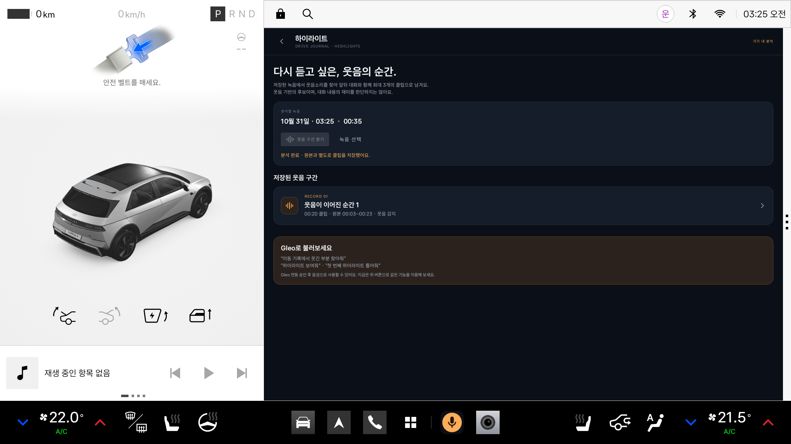
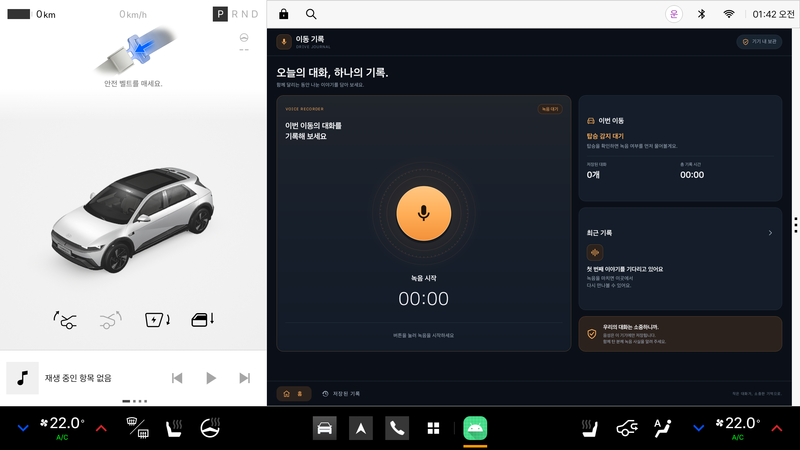
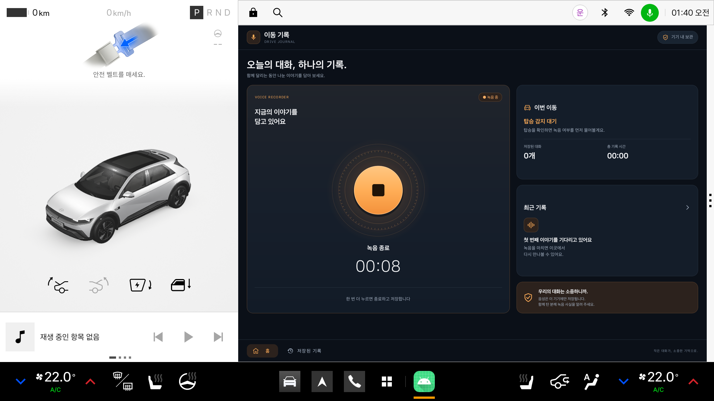

# ?? README ?? ? 2026-11-14 ???

? ??? ?? ?? ?????. ?? ??? [?? README](../README.md)? ?????.

# 티키타카

> **공모전 제출 준비 중 (2026-11-14):** [현재 실행·빌드 방법 및 제출 현황](../docs/CONTEST_SUBMISSION_2026-11-14.txt), [시연 영상 촬영안](../docs/CONTEST_DEMO_2026-11-14.txt)을 먼저 확인하세요. 티키타카 전용 키로 release APK 서명을 완료했으며, 공개 다운로드·제출 커밋·영상 링크는 아직 확정되지 않았습니다. 아래 날짜별 기록은 과거 구현을 포함하며, 현재 Android 앱에 별도 서버 실행은 필요하지 않습니다.

**현재 앱 경로 (2026-11-14):** 녹음 → 기기 YAMNet·Pleos ON_DEVICE STT·화자 분석 → 기기 하이라이트 선택 → Qwen3 대화 제목·장면 구성 → 기기 Media3 영상 저장으로 처리합니다. 자체 백엔드·로그인·API 키는 필요하지 않습니다. 대화 모델은 최초 약 1.3GB를 HTTPS로 내려받은 뒤 기기 안에서 사용합니다. 음성·전사문은 전송하지 않습니다. 모델이 없거나 실행에 실패하면 기본 제목·구도로 제작하고 결과에 표시합니다. 휴대폰 연결·동기화·공유 기능은 제거했으며 기존 녹음·영상·분석 자료는 보존합니다. [제목·장면 및 release 종료 처리 검증](../docs/DIALOGUE_STORY_AND_RELEASE_POWER_2026-11-14.txt).

**release 종료 처리:** 공개 AAOS `IGNITION_STATE`의 새 OFF 이벤트를 구독해 녹음을 마감하고 저장을 검증합니다. OS `ACTION_SHUTDOWN`도 별도로 처리합니다. 현재 Pleos v2.1.0 에뮬레이터는 `IGNITION_STATE` 속성을 제공하지 않아 실제 시동 OFF 경로는 이 이미지에서 검증할 수 없습니다. 속성 미지원·연결 끊김을 OFF로 간주하지 않습니다.

**새 버전 자동 제작:** 확인창 없이 현재 감도로 다시 분석하고 감지한 화자 수에 맞춰 캐릭터를 배치합니다(최대 4명, 미확정은 임시 2명). 웃음 기준 기본값은 0.001이며 0.005도 선택할 수 있습니다. [변경·검증 기록](../docs/AUTOMATIC_PRODUCTION_2026-11-13.txt).

아래 날짜별 웹/서버 음성 업로드 설명은 이전 구현 기록입니다. 웹 실험 도구는 유지하지만 현재 앱의 원음 업로드·서버 목소리 등록은 차단했습니다. 기존 녹음·영상·분석·목소리 등록 자료는 보존합니다.

**2026-11-12 차량 앱 업데이트:** 사용자 Figma의 **티키타카** 화면을 적용했다. 홈·보관함·캐릭터 8종·내 정보·목소리 확인·녹음 및 재생 화면을 네이티브 Android로 구성하고, 녹음 종료 후 하이라이트와 영상의 자동 제작을 연결했다. `이번에는 녹음만 보관`을 선택하면 자동 전송·제작하지 않는다. 앱 패키지와 기존 자료는 유지한다.

[현재 Figma 적용·검증 범위](../docs/FIGMA_IMPLEMENTATION_2026-11-12.md) · [변경 전 구현 기술·처리 로직 정리](../docs/IMPLEMENTED_TECHNOLOGY_2026-11-12.md) · [디자인 원본 관리](../design/README.md)

아래 기존 화면·탑승 설정·다인 프로필 설명은 이전 버전 이력이다. 새 UI는 내 프로필 1개를 사용한다. 휴대폰 기능은 사용자 요청으로 제거했다. 기존 Figma의 휴대폰 화면은 현재 지원 범위에서 제외한다.

`app/`은 기기 안에서 녹음·분석·영상 제작을 수행합니다. `server/`의 기존 PC 음성/영상 실험 도구는 별도로 유지하며, 현재 앱 제작 경로에서 호출하지 않습니다. PC 실험 도구 실행은 [백엔드 실행 안내](../server/README.md)를 따릅니다.

현재 앱 제작 경로에는 회원가입·서버 인증이 없습니다. 이전 서버 실험용 설치 인증 코드와 기존 자료는 보존하지만 새 기기 제작에는 사용하지 않습니다.

**차량 탑승을 계기로 녹음 여부를 묻고, 함께 나눈 대화를 기기에 저장해 다시 듣는 Pleos Connect 앱입니다.**

현대자동차그룹 차량용 앱 개발 공모전을 준비하는 Android 프로토타입입니다. 사용자 동의 후 녹음·저장·재생하며, **녹음 종료 후 기기 분석, 기기 내 자동 하이라이트 구성, 캐릭터 영상 제작**을 구현했습니다. 앱의 현재 하이라이트는 웃음 전후 문맥을 포함하는 규칙 기반 선택이며 웹의 Qwen 주제 분석과 구분합니다. 웃음 없는 대화의 재미 평가와 실제 Gleo 음성 호출 승인은 아직 포함하지 않습니다.

Gleo 하이라이트 기능은 `main`에 병합했습니다. 현재 작업 폴더에는 탑승 안내와 **Gleo 사용하기 버튼**도 반영되어 있습니다. Debug와 release 모두 **이동 기록** / `com.example.hd_project`로 통합했으며, 같은 서명으로 설치하면 기존 앱과 녹음을 유지하면서 업데이트합니다. [Gleo 구현·시연 방법](../docs/GLEO_HIGHLIGHTS.md)을 먼저 확인하세요.



위 화면은 공개 웃음 테스트 음원의 앞뒤에 무음을 붙인 35초 파일에서 약 20초의 클립을 실제 저장한 결과입니다. 사용자 녹음이나 실제 Gleo 음성 호출 시연 화면은 아닙니다. 초기 하이라이트 검증은 단위 테스트 14개·기기 테스트 8개 통과입니다. Gleo 버튼 추가 후 **빌드·단위 테스트 25개 통과, Lint 오류 0개·경고 17개**, 에뮬레이터에서 녹음 저장 후 Gleo 듣기 전환을 확인했습니다.

하이라이트는 **2026-11-06 서버 자동 처리 구조**로 변경했습니다. 앱의 수동 찾기 버튼은 제거했으며 저장된 결과 보기·재생은 유지합니다. 아래 기존 화면 이미지와 초기 검증 수치는 2026-10-31 기록입니다.

[실행 방법](#실행-방법) · [APK 안내](#apk-안내) · [검증 결과](#검증-결과) · [현재 한계와 개발 계획](#현재-한계와-개발-계획)



2026-10-31에 촬영한 실제 에뮬레이터 실행 화면입니다. 오른쪽의 이동 기록 화면이 이 프로젝트의 앱 영역이며, 왼쪽 차량 화면과 상·하단 시스템 영역은 Pleos Connect가 제공합니다.

## 기획 배경과 차량 특화

가족이나 친구와 함께 이동하다 나눈 이야기를 나중에 다시 듣고 싶은 상황에 주목했습니다. 차에 탈 때 기록 여부를 먼저 확인하고, 사용자가 선택한 대화를 하나의 녹음으로 남기는 것이 현재 구현의 중심입니다.

- **차량 신호와 연결:** Pleos Vehicle SDK의 앞좌석 왼쪽 점유 상태를 읽어 녹음 시작 여부를 안내합니다. 점유 상태는 안내의 단서로만 사용합니다.
- **차량 화면에 맞춘 조작:** 큰 시작·종료 버튼, 경과 시간, 탑승 상태, 최근 기록을 표시합니다. 앱 창 너비가 900dp 이상이면 두 열로, 그보다 좁으면 세로로 배치합니다.
- **함께 이동한 경험의 보관:** 저장된 대화를 날짜·시간과 함께 다시 듣습니다. 향후 재미있었던 대화 구간을 찾는 리플레이 경험으로 확장하려 합니다.

주요 사용 대상은 가족·친구와 차량을 함께 이용하는 사람입니다. 사용자 수와 재이용률은 아직 측정하지 않았습니다.

## 구현된 기능

| 기능 | 현재 동작 |
|---|---|
| 탑승 안내 | 운전석 점유가 1.2초 유지되면 녹음 카드에 안내합니다. '앱을 닫아도 탑승 안내'를 켜고 알림을 허용하면 화면 밖에서도 좌석을 구독하고 탑승 알림을 보냅니다. 알림을 열어도 녹음은 시작되지 않습니다. |
| 안내 대기 복원 | 별도 `specialUse` 서비스가 마이크 없이 대기합니다. 프로세스 재생성과 앱 업데이트 후 복원을 확인했습니다. 재부팅 수신 처리는 구현했지만 실제 재부팅·시동·절전 복귀는 미검증입니다. |
| 동의·권한 확인 | 시작 선택과 마이크 권한 허용 후 녹음합니다. 건너뛰기·취소·권한 거절 시 녹음하지 않습니다. |
| 녹음 유지·종료 | 마이크 포그라운드 서비스로 시작한 녹음을 앱 밖에서도 유지하며, 앱 버튼이나 시스템 알림에서 종료합니다. |
| 녹음 상태 표시 | 경과 시간과 시작·녹음·저장·오류 상태를 표시합니다. 마이크 버튼의 파형은 실제 입력 크기에 반응합니다. |
| 기록 보관·재생 | 앱 전용 공간에 M4A 파일을 저장하고 목록에서 재생·일시정지·삭제합니다. |
| MOMO 영상 만들기 | 저장된 녹음을 서버에서 분석하고 제공받은 캐릭터·차량·배경으로 540×960/30fps MP4를 기기에서 만듭니다. 캐릭터·배경·자막 편집 메뉴는 없습니다. |
| 기록 대시보드 | 실제 저장 파일을 바탕으로 기록 수, 총 시간, 가장 최근 기록을 표시합니다. |
| 웃음 기반 하이라이트 | 새 녹음 저장 → 자동 업로드 → 서버 YAMNet(0.1)·Whisper STT·Qwen 주제 구간 선택 → 최대 3개 M4A 저장 → 앱 자동 다운로드. 원본은 유지하며 서버 연결 실패 시 자동 재시도합니다. |
| Gleo 인터페이스 | 하이라이트 목록 표시·번호 재생의 2개 action을 제공합니다. 과거 찾기 action은 상태·결과 표시만 하며 분석을 시작하지 않습니다. 실제 음성부터 앱 응답까지는 재시험이 필요합니다. |
| Gleo 사용하기 | 하단 버튼으로 Gleo 듣기를 요청합니다. 녹음 중에는 먼저 저장·종료하고 마이크를 해제합니다. Pleos Connect v2.1.0 / Gleo 4.2.0.15에서 확인한 호환 동작입니다. |
| 예외 처리 | 저장 공간 부족, 짧은 녹음, 저장 실패를 처리합니다. Android API 29 이상에서는 입력 무음 처리 통지를 확인해 녹음을 종료하는 경로가 있습니다. |

<details>
<summary>녹음 중 화면 보기</summary>



주변 대화 수집을 피하기 위해 PC 마이크 입력을 끈 상태에서 촬영한 시험 화면입니다. 실제 차량의 음질이나 음성 입력 성능을 증명하는 자료는 아닙니다.

</details>

## 실행 방법

### 앱에서 MOMO 영상 만들기

**저장된 기록 → 기록의 영상 만들기 → 영상 만들기**에서 분석·MP4 제작·재생·저장을 실행합니다. 기존 기본 도형 캐릭터와 SRT 편집 화면은 제거했습니다. 제공받은 PNG 캐릭터·차량·배경 MP4와 고정 설정을 사용하며 최초 분석에는 이 프로젝트의 `server/`가 필요합니다. 분석이 기기에 저장된 기록은 서버 없이 다시 제작할 수 있습니다. [실행·리소스·설정·저장 위치](../docs/app-animation.md)를 확인하세요.

### 녹음 종료 후 자동 하이라이트

앱에서 영상 만들기용 녹음을 종료하면 기기 안에서 자동 처리합니다. 원음·전사문·분석 결과를 업로드하지 않으며, 보관함에서 결과를 확인합니다. 30초 단위 기기 분석 체크포인트로 중단 후 이어갑니다. 프로젝트의 입력 검증 한도는 12시간, 앱 클립 기본 길이는 최대 40초·3개이며 최대 120초를 선택할 수 있습니다. 2~3시간 실시간 성능은 아직 측정하지 않았습니다. [현재 흐름·저장 위치](../docs/LOCAL_METADATA_PIPELINE_2026-11-12.md).

### PC에서 음성 파일로 하이라이트 MP4 만들기

YAMNet 웃음 기준 **0.1** → Whisper 한국어 전사 → Qwen 주제 경계 추정 → 최대 3개 M4A·자막 MP4 생성을 자동으로 실행하는 PC 도구를 추가했습니다. 고정된 앞뒤 초 대신 대화 주제의 시작과 끝을 사용합니다.

```powershell
.\run-highlights.ps1 -InputFile 'C:\path\call.m4a'
```

모델 설치, 환경 요구 사항, 출력 파일은 [하이라이트 파이프라인 안내](../tools/highlight_pipeline/README.md)에 있습니다. 이 명령은 PC 단독 MP4 도구입니다. 앱의 자동 하이라이트는 `server/momo/highlights/`로 옮긴 분석 코드를 API로 실행하고 M4A를 저장합니다.

### 개발·테스트 환경

| 항목 | 프로젝트 설정·확인 환경 |
|---|---|
| 개발 언어·UI | Kotlin, Android XML Views, Material Components |
| Gradle / Android Gradle Plugin | 9.6.0 / 9.4.1 |
| 빌드 JVM | JDK 25 — `gradle/gradle-daemon-jvm.properties`에 지정 |
| Java 소스·타깃 호환성 | Java 17 |
| Android SDK | `compileSdk 37`, `targetSdk 37`, `minSdk 28` |
| Pleos Vehicle SDK | `ai.pleos.playground:Vehicle:2.3.2` |
| 확인한 에뮬레이터 | `Pleos_Connect_v2.1.0`, Android 14 / API 34, x86_64 |
| 앱 패키지·버전 | debug/release `com.example.hd_project`, 1.1 (`versionCode 2`) |
| 앱 자동 하이라이트 분석 | 기기 YAMNet + Pleos SpeechToText 3.3.1 ON_DEVICE 시도 + 기기 규칙 선택 |
| PC 웹 실험 | 기존 Whisper·Qwen·서버 렌더러 유지 (현재 앱 경로와 다름) |

`minSdk`는 설치 하한 설정입니다. 모든 Android 기기나 차량에서 검증했다는 뜻은 아닙니다. 차량 기능 시험에는 Pleos Connect 환경이 필요합니다.

### 1. 프로젝트 열기와 빌드

```powershell
git clone https://github.com/Controllls/HD_project.git
cd HD_project
.\gradlew.bat assembleDebug
```

빌드 전에 다음 환경을 준비합니다.

1. 프로젝트의 Android Gradle Plugin 버전을 지원하는 Android Studio와 Android SDK Platform 37을 설치합니다.
2. Android Studio에서 저장소 루트를 열고 Gradle Sync를 실행합니다. 로컬 SDK 경로는 각 PC의 `local.properties`로 설정하며 Git에는 포함하지 않습니다.
3. JDK 25를 사용할 수 있게 설정합니다. Gradle·SDK·의존성을 처음 내려받을 때는 네트워크 연결이 필요합니다.
4. Pleos 개발 환경 안내에 따라 에뮬레이터를 설치합니다. Vehicle SDK 저장소는 `settings.gradle.kts`에 선언되어 있습니다.

macOS·Linux의 빌드 명령은 `./gradlew assembleDebug`입니다. 실제 실행 검증은 위 표의 Windows/Pleos 에뮬레이터 환경에서 진행했습니다.

### 2. 설치와 실행

Android Studio에서 실행 구성 `app`, 실행 대상 `Pleos_Connect_v2.1.0`을 선택하고 Run을 실행합니다. 또는 Windows의 기본 Android SDK 설치 경로에서 다음 명령을 사용할 수 있습니다.

```powershell
$adb = Join-Path $env:LOCALAPPDATA 'Android\Sdk\platform-tools\adb.exe'
& $adb devices
& $adb -s emulator-5554 install -r app\build\outputs\apk\debug\app-debug.apk
& $adb -s emulator-5554 shell am start -n com.example.hd_project/.MainActivity
```

SDK 설치 위치와 기기 ID는 본인 환경에 맞게 바꿉니다.

### 3. 마이크와 좌석 설정

- **음성 입력:** 에뮬레이터 확장 설정의 Microphone에서 `Virtual microphone uses host audio input`을 켭니다. Windows에서도 Android Emulator의 마이크 접근을 허용해야 합니다. 앱에서는 마이크 권한을 허용합니다.
- **알림:** 알림 권한을 허용하면 녹음 상태와 종료 버튼을 알림에서 확인할 수 있습니다.
- **탑승 안내:** 앱을 연 상태에서 Virtual Console의 Seat / Occupancy → Driver를 OFF로 바꾸고 2초 기다린 뒤 ON으로 바꿉니다. 실제 차량 센서가 아닌 에뮬레이터의 시험 입력입니다.
- **화면 밖 탑승 안내:** 오른쪽 '앱을 닫아도 탑승 안내'를 켜고 알림을 허용한 뒤 내비게이션을 엽니다. Driver를 Empty로 2초, Occupied로 변경하면 시스템 알림에서 '이번 이동을 기록할까요?'를 확인할 수 있습니다. 이 Pleos 이미지에서는 HOME 키만으로 앱이 숨겨지지 않을 수 있습니다.
- **알림 위치:** 현재 탑승 안내는 알림창 안에 등록되며 내비 화면 위의 배너로 뜨지 않습니다. Android Automotive는 일반 앱의 헤드업 알림 종류를 제한하며, 현재 `CATEGORY_REMINDER`는 대상이 아닙니다. ADB로 알림창을 여는 시험은 `adb -s emulator-5554 shell cmd statusbar expand-notifications`로 할 수 있습니다. [공식 알림 동작](https://developer.android.com/training/cars/platforms/automotive-os/notifications)

Virtual Console 연결이 필요한 경우:

```powershell
& $adb -s emulator-5554 forward tcp:8088 tcp:8088
```

브라우저에서 `http://127.0.0.1:8088/`을 열고 콘솔 페이지를 유지한 채 조작합니다. PC의 포트를 에뮬레이터 내부 Virtual Console로 연결하는 설정이며, 에뮬레이터나 ADB를 재시작해 연결이 사라지면 위 명령을 다시 실행합니다. PC의 8088 포트를 다른 프로그램이 쓰는 경우에만 왼쪽 포트를 `tcp:18088`로 바꾸고 브라우저에서도 18088을 사용합니다. 센서 연결이 실패해도 앱의 마이크 버튼으로 녹음을 시작할 수 있습니다.

### 4. 기본 시연 흐름

1. 앱을 열고 좌석 입력을 변경하거나 가운데 마이크 버튼을 누릅니다.
2. 녹음 안내를 읽고 함께 탄 사람에게 녹음 사실과 동의를 확인한 뒤 **녹음 시작**을 선택합니다.
3. 마이크 권한을 허용하고 녹음 상태·경과 시간을 확인합니다.
4. 홈 화면으로 이동했다가 앱으로 돌아와 녹음이 유지되는지 확인합니다.
5. 앱의 종료 버튼 또는 알림의 **녹음 종료**를 누릅니다.
6. **저장된 기록**에서 파일을 재생·일시정지·삭제합니다.

## APK 안내

**제출용 release APK는 아직 등록하지 않았습니다. 현재는 소스를 빌드해 debug APK로 실행할 수 있습니다.**

| 구분 | 위치·상태 |
|---|---|
| 개발용 debug APK | `assembleDebug` 실행 후 로컬 `app/build/outputs/apk/debug/app-debug.apk`에 생성됩니다. Git에는 포함하지 않습니다. |
| 공모전 제출용 release APK | 준비 중입니다. 현재 프로젝트에는 release 서명 설정이 없습니다. |
| 제출 시 파일 경로 | 공식 파일명 형식에 맞춰 `apk/팀명_이동기록_release.apk`로 제공할 예정이며, 현재 존재하는 다운로드 경로는 아닙니다. |

공식 안내는 소스와 실행 가능한 release APK를 함께 제공하도록 요구합니다. 저장소의 `apk/` 폴더에 넣고, 업로드 용량을 초과하면 GitHub Releases를 이용합니다. 등록 후 이 절에 실제 다운로드 링크를 추가해야 합니다. [공식 지원·제출 방법](https://appdevchallenge.auto-hmg.io/guide/submission)

현재 `.gitignore`는 APK를 제외하므로 제출 파일을 등록할 때 해당 파일의 추적 여부도 확인해야 합니다. 개발용 debug APK를 제출용 release APK로 표시하지 않습니다.

## 구현 및 검증 결과

기존 녹음·탑승 안내 검증 기준은 **2026-10-31**입니다. **2026-11-05 MOMO 영상 통합**의 실행·검증 범위는 [MOMO 영상 안내](../docs/app-animation.md), 출력 규격은 [MP4 검사 결과](../docs/momo-video-validation.json)에 기록합니다. 아래 표와 [시퀀스 다이어그램](../docs/sequence/시퀀스다이어그램.html)은 기존 녹음·탑승 안내 기록이며 MOMO 서버 연동은 포함하지 않습니다.

```powershell
.\gradlew.bat :app:assembleDebug :app:testDebugUnitTest :app:lintDebug :app:assembleDebugAndroidTest
```

| 검사 | 결과 |
|---|---|
| Debug 앱·기기 테스트 APK 빌드 | 통과 |
| 단위 테스트 | 25개 통과 |
| Android Lint | 오류 0개, 경고 17개 |
| 선택한 기기 테스트 | 8개 통과 — 패키지 1개, Gleo 호출 규약 5개, 화면 레이아웃 2개. 기존 설치를 유지하고 직접 ADB instrumentation으로 실행 |
| 3분할 화면 | 차량·앱·내비 동시 표시 확인. 앱 폭 1682→841dp 전환 후 프로세스 유지·새 강제 종료 없음 |
| 기존 백그라운드 탑승 안내 기록 | 내비게이션 표시 중 알림, 알림에서 카드 열기, 자동 녹음 없음, 건너뛰기, 다음 탑승, 안내 끄기, 실제 프로세스 종료·APK 업데이트 후 대기 복원 확인 |
| 기존 에뮬레이터 시연 기록 | 동의·건너뛰기·권한 거절, 다음 탑승 안내, 홈 이동 후 녹음 유지, 버튼·알림 종료, 저장·재생·삭제 확인 |

마지막 두 행은 [실행·검증 기록](../예제_실행방법.txt)에 남긴 기존 에뮬레이터 시험 결과입니다. 기존 녹음 시연은 호스트 마이크를 끈 시험이었습니다. 이후 사용자가 녹음한 약 10.26초 M4A의 정상 디코딩과 오디오 신호를 확인하고 Windows로 복사했지만, 장시간 녹음·실차 음질·통화/Gleo 경합까지 검증한 것은 아닙니다. Gleo 자연어 명령의 전체 처리 성공과 정식 연동 승인은 별도 확인 대상입니다.

### 좌석 점유 값 호환 처리

현재 조합인 **Vehicle SDK 2.3.2 + Pleos Connect v2.1.0**에서는 Virtual Console의 Driver OFF가 SDK Boolean `true`, ON이 `false`로 관찰되어 `PleosSeatOccupancyCompat`에서 반전합니다. SDK나 차량 펌웨어가 달라지면 반드시 다시 확인해야 합니다.

SDK Boolean만으로 복구할 수 없는 미확인 원시 값도 있습니다. 이 값은 질문을 표시하는 단서로만 사용하며 녹음 동의를 대신하지 않습니다.

## 데이터와 권한

- 저장 형식: **AAC / M4A, 모노, 44.1 kHz, 96 kbps**.
- 저장 위치: 앱 전용 `noBackupFilesDir/recordings`. 녹음 파일은 Android 백업·기기 이전 대상에서 제외되며 앱을 삭제하면 함께 삭제됩니다.
- 새 영상 제작에서는 원음·PCM·목소리 임베딩을 업로드하지 않습니다. 기기 분석 체크포인트와 전사문은 `noBackupFilesDir/metadata-episodes/`에 저장하며 자동 삭제하지 않습니다. 전사문도 개인정보일 수 있습니다.
- 서버 `/v1/episodes/metadata`는 설치 인증 후 텍스트·감지 이벤트를 처리하고 하이라이트 범위를 응답합니다. 이 경로는 음성 추론이나 외부 AI API를 호출하지 않고, 요청 전사문을 서버 파일·작업 DB에 저장하지 않습니다.
- 앱의 하이라이트 M4A는 `noBackupFilesDir/highlights/local-.../`, 완성 영상·자막은 `noBackupFilesDir/momo-videos/`에 저장됩니다. 이전 서버 작업과 자료의 보관 정책은 해당 과거 문서를 참조합니다.

| 권한 | 사용 목적 |
|---|---|
| `pleos.car.permission.CAR_SEATS` | 지원 좌석 확인 및 점유 상태 조회·구독 |
| `RECORD_AUDIO` | 사용자 동의 후 마이크 입력 녹음 |
| `INTERNET` | 설치 인증·전사문/감지 이벤트 전달·하이라이트 계획 수신 |
| `pleos.car.permission.STT_SERVICE` | Pleos 음성 인식 서비스 연결 (ON_DEVICE) |
| `FOREGROUND_SERVICE`, `FOREGROUND_SERVICE_MICROPHONE` | 시작한 녹음을 앱 밖에서도 유지 |
| `FOREGROUND_SERVICE_SPECIAL_USE` | 사용자가 켠 좌석 구독 대기 서비스, 마이크 사용 없음 |
| `RECEIVE_BOOT_COMPLETED` | 기존 안내 설정에 따라 재부팅 후 대기 시작 시도 |
| `POST_NOTIFICATIONS` | 탑승 안내, 대기 상태, 녹음 알림과 종료 동작 표시 |

## 현재 한계와 개발 계획

### 현재 한계

- 안내를 켠 이후 앱 화면 밖 탑승 감지는 구현했습니다. 최초 한 번은 앱을 열어야 하며, 강제 종료 후 자동 실행은 하지 않습니다. `BOOT_COMPLETED` 처리는 실제 재부팅에서 검증하지 않았고, 차량 시동·절전 복귀마다 실행되는지도 미확인입니다.
- `specialUse` 서비스와 차량 좌석 권한은 에뮬레이터 실행과 별개로 Pleos 배포 허용 확인이 필요합니다. OS가 대기를 종료하거나 좌석 연결이 끊긴 동안에는 안내를 놓칠 수 있습니다. 앱이 중단된 사이에 빈 좌석과 재탑승을 모두 놓치면 새로운 이동을 구분할 수 없습니다.
- 좌석에서 내리는 것만으로 녹음을 종료하지 않습니다. 사용자 버튼·알림 동작 또는 오류 처리로 종료합니다.
- 통화·Gleo 사용으로 입력이 제한된 후 자동으로 녹음을 재개하는 기능은 없습니다. 실제 Pleos 차량의 마이크 접근·입력 경로·충돌 동작은 검증이 필요합니다.
- 전원 차단·강제 종료로 남은 `.pending` 녹음 파일의 복구는 구현하지 않았습니다.
- 주행 상태에 따른 화면·조작 제한은 구현하지 않았습니다. 현재 시연 절차는 정차 상황을 기준으로 합니다.

### 후속 개발 방향 — 미구현

| 방향 | 확인·개발할 내용 |
|---|---|
| AI 대화 리플레이 확장 | 서버 자동 하이라이트는 주제 단위 M4A를 저장합니다. 현재 MOMO 영상은 선택한 녹음 전체를 제작하며 하이라이트 클립의 자동 영상화는 별도 후속 작업입니다. |
| Gleo 실환경 검증 | 앱 인터페이스는 구현했습니다. 스키마 등록·승인과 실제 자연어 음성 호출 시험이 필요합니다. |
| 실차 검증 | 차량 마이크, 내비 화면 전환, 통화·Gleo 전후 입력 상태, 목표 녹음 시간 동안의 안정성을 확인합니다. |
| 제출·배포 준비 | release APK 서명·실행 확인, 시연 영상, 라이브러리·리소스 사용 조건 점검을 진행합니다. |

Gleo가 들은 전체 대화나 음성 원본을 앱이 전달받는 기능을 전제로 하지 않습니다. 현재 녹음은 Android `MediaRecorder`로 구현되어 있으며 Pleos STT·TTS·LLM SDK는 사용하지 않습니다.

## 코드 구조

소스 디렉터리: [`app/src/main/java/com/example/hd_project`](../app/src/main/java/com/example/hd_project)

| 파일 | 역할 |
|---|---|
| `MainActivity.kt` | 녹음 동의·권한, 홈 화면 상태와 기록 통계 |
| `BoardingCoordinator.kt` | 화면과 대기 서비스의 단일 좌석 구독, 탑승 상태 저장·복원, 제한된 재연결 |
| `BoardingService.kt` / `BoardingNotifications.kt` | 마이크 없는 탑승 대기, 상태·탑승 알림 |
| `BoardingBootReceiver.kt` / `BoardingActionReceiver.kt` | 기존 설정 복원 진입점, 알림 건너뛰기·안내 끄기 |
| `VehicleSeatMonitor.kt` | 좌석 지원 확인, 현재 값·이벤트 구독, 상태 안정화 |
| `PleosSeatOccupancyCompat.kt` / `BoardingPromptGate.kt` | 현재 SDK 값 보정, 탑승 질문 중복 방지 |
| `RecordingService.kt` / `RecordingState.kt` | 마이크 서비스·알림·종료 처리, 녹음 상태 공유 |
| `RecordingFiles.kt` / `RecordingsActivity.kt` | 파일 저장·목록·재생·삭제 |
| `RecordingButtonView.kt` | 마이크 버튼과 입력 크기 시각화 |
| `AnimationActivity.kt` / `momo/MomoVideoViewModel.kt` | 고정 구성 영상의 생성·취소·재생·저장 |
| `PeopleActivity.kt` / `momo/people` | [사용자 관리](../docs/people-voice-matching.md), 이름·캐릭터·등록 목소리 암호화 저장, 녹음 간 인물 매칭 |
| `momo/render` / `momo/storage` / `momo/network` | 리소스 합성, Media3 MP4, Room/WorkManager 분석 캐시, API 인증 |
| `server/momo` | 인증·분석 작업 API와 실제 음성 모델 추론 |

화면 XML은 [`res/layout`](../app/src/main/res/layout), 넓은 화면 구성은 [`res/layout-w900dp`](../app/src/main/res/layout-w900dp), 단위 테스트는 [`src/test`](../app/src/test)에 있습니다.

## 참고 자료

- [상세 실행 방법과 기존 검증 기록](../예제_실행방법.txt)
- [화면 구성과 디자인 적용 기록](../디자인_구성안.txt)
- [공모전 지원·제출 방법](https://appdevchallenge.auto-hmg.io/guide/submission) · [심사 기준](https://appdevchallenge.auto-hmg.io/guide/judging-awards) — 2026-10-31 확인
- [Pleos Connect 개발 문서](https://document.pleos.ai/en/docs/connect/guide/connect) · [Gleo Interface](https://document.pleos.ai/en/docs/pleos-only/app-integration-guide/guide/core-concepts)
- [Android 마이크 포그라운드 서비스](https://developer.android.com/develop/background-work/services/fgs/service-types#microphone) · [오디오 입력 공유](https://developer.android.com/media/platform/sharing-audio-input)
- 주요 외부 의존성: [AndroidX](https://android.googlesource.com/platform/frameworks/support/), [Material Components for Android](https://github.com/material-components/material-components-android), [JUnit 4](https://github.com/junit-team/junit4), Pleos Vehicle SDK. 각 의존성의 라이선스·SDK 이용 조건을 따릅니다.
